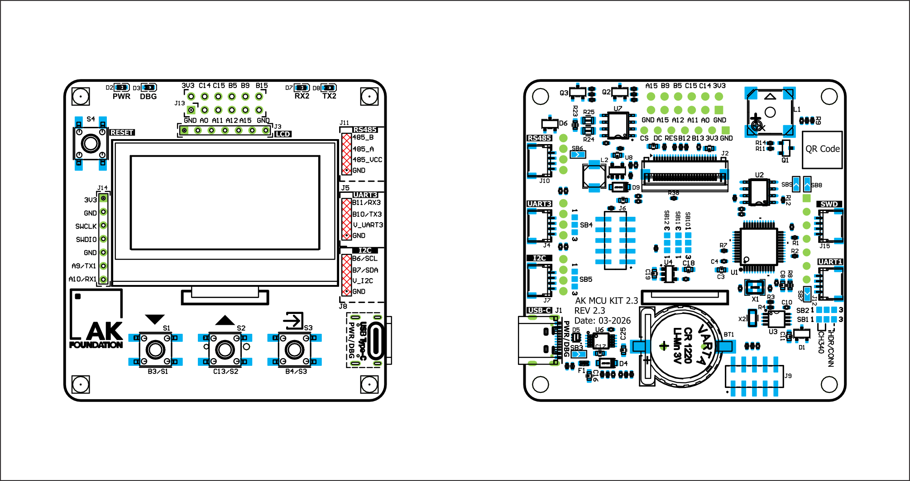

<div align="center">
  


</div>

# Mini Clock - Digital Desk Clock built on AK Embedded Base Kit

## Demo

## Documentation

| File | Description |
|---|---|
| [README.md](README.md) | Main project overview, hardware information, operation, and object descriptions. |
| [AGENTS.md](AGENTS.md) | Rules and runtime model for AI coding agents (Codex, Claude Code via [CLAUDE.md](CLAUDE.md)). |

## Introduction

Mini Clock is a digital desk clock built on the AK Embedded Base Kit.

This project focuses on building a simple clock application using an event-driven approach. It handles basic features such as displaying time, updating the screen, reading button inputs, and triggering an hourly chime.

Through this project, I practiced several embedded concepts:

* **System design:** Organizing the main features and logic of the clock.
* **Task management:** Splitting the program into small tasks such as time update, display update, and button handling.
* **Communication:** Using signals, timers, and messages to handle events.
* **State machine:** Managing clock modes such as normal display, setting time, and chime control.

### I. Hardware

<table align="center">
  <tr>
    <td align="center"></td>
  </tr>
</table>
<p align="center"><strong><em>Figure 1:</em></strong> AK Embedded Base Kit - STM32L151</p>

[AK Embedded Base Kit](https://epcb.vn/products/ak-embedded-base-kit-lap-trinh-nhung-vi-dieu-khien-mcu) is a development kit for people who already have some experience with embedded programming and want to learn more through practice.

The board includes a **1.54-inch OLED display**, **3 push buttons**, and **a buzzer** that can play simple sounds or short melodies. With these built-in parts, you can create small games, menu systems, clocks, and other interactive projects. It is also a good way to learn how **event-driven programming** works in a real embedded system.

The kit also supports **RS485**, **Qwiic**, and **Grove** connections. This makes it easy to connect sensors, modules, and other devices when testing or building embedded projects.

**MCU Overview:**

```text
SoC Name : STM32L151CBT6
RAM      : 16 KB

Flash Partitions Layout
----------------------
[ 0x08000000 - 0x08001FFF ] : Bootloader Partition (8 KB)
=> AK Bootloader

[ 0x08002000 - 0x08002FFF ] : BSF Shared Partition (4 KB)
=> Used for data sharing between Bootloader and Application

[ 0x08003000 - 0x0801FFFF ] : Application Partition (116 KB)
=> Mini Clock firmware
```

**MCU Naming Convention:**

| Part | Meaning |
|---|---|
| `STM32` | STMicroelectronics 32-bit MCU family. |
| `L` | Low-power series. |
| `151` | STM32L151 product line. |
| `C` | 48-pin package. |
| `B` | 128 KB Flash memory. |
| `T` | LQFP package. |
| `6` | Industrial temperature grade. |


<table align="center">
  <tr>
    <td align="center"></td>
  </tr>
</table>
<p align="center"><strong><em>Figure 2:</em></strong> Board view Top + Bottom </p>

**External RTC:** time is kept by a **PCF85063A** module on the Qwiic/Grove I2C port (I2C1: SCL `PB6`, SDA `PB7`, address `0x51`). The RTC holds Vietnam local time (UTC+7); other time zones are derived from it.

### II. Features

| Screen | What it does |
|---|---|
| Digital | Large `HH:MM:SS`, weekday bar and date. 12h/24h format. |
| Analog | Clock face with hour, minute and second hands, date and UTC offset. |
| Alarm | Up to 10 daily alarms (time + on/off), saved to EEPROM. |
| Stopwatch | 0.1 s resolution with up to 10 laps. Keeps counting when you leave the screen. |
| Timer | Countdown up to 23:59:59. Keeps counting when you leave the screen. |
| World Clock | 32 cities. The selected city is also the display time zone of every other screen. |
| Calendar | Month grid, per-day event list, up to 10 events with category, start/end time and an optional reminder. |
| Setting | Time & date, display (12/24h, colour invert, brightness), sound (mute, hourly chime, alarm melody), reset. |
| Exit | Idle animation (bouncing balls). |

**Ringing.** An alarm, a finished timer or a calendar reminder opens a full-screen **ALARM / TIMER / EVENT** page from any screen. The melody repeats every 5 s; any key dismisses it, and it stops by itself after 60 s. A source that fires while another one is ringing replaces it.

**Persistence.** Settings, alarms and calendar events are stored in the MCU's data EEPROM (each record has a magic number and checksum; an invalid record falls back to defaults). The alarm bank is only rewritten when its content changes.

### III. Controls

Buttons: **Mode**, **Up**, **Down**. *Long* = hold, *Mode+Up* / *Mode+Down* = press Up or Down while holding Mode.

| Screen | Controls |
|---|---|
| Digital / Analog | Mode: open the menu. |
| Menu | Up / Down: previous / next item. Mode: open. |
| Alarm (list) | Up / Down: move. Mode: edit the alarm, or *Add New* / *Back*. Long Up: on/off. Long Down: delete. Mode+Up: add and edit. Mode+Down: back to menu. |
| Alarm (edit) | Up / Down: change the value. Mode or Long Mode: next field (on *Delete?* Mode deletes, on *Save?* it saves). |
| Stopwatch | Mode: start / pause. Long Mode: reset. Up: lap. Down: scroll laps. Long Up / Long Down: back. |
| Timer | Mode: start / pause. Up / Down: change the selected field. Mode+Up / Mode+Down: next / previous field. Long Up: reset. Long Down: back. |
| World Clock | Up / Down: change city. Mode: back. |
| Calendar (month) | Up / Down: previous / next day. Long Up / Long Down: previous / next month. Mode: open the day. Long Mode: add an event. Mode+Up: back to menu. |
| Calendar (day list) | Up / Down: next / previous event (Down on an empty day adds one). Mode: edit. Long Mode: delete. Long Up / Long Down: back to the month. |
| Calendar (edit) | Up / Down: change the value. Mode: next field (the last field saves). Long Mode: save, or cancel a new event. Long Down: cancel. |
| Setting | Up / Down: move. Mode: select. In *Time*, Up / Down change the field and Mode moves to the next one until *OK*. |
| Ringing | Any key: dismiss. |

### IV. Software Architecture

The firmware is built on the AK (Active Kernel) event-driven framework: every object is a task that only communicates through messages, and every handler runs to completion without blocking.

| Task | Priority | Responsibility |
|---|---|---|
| `MC_CLOCK_RTC_ID` (`task_mc_rtc`) | 5 | 1 Hz service tick; polls the RTC alarm flag; owns every RTC write and retries one the RTC did not acknowledge. |
| `MC_CLOCK_TIME_ID` | 4 | Local time for the selected time zone; hourly chime. |
| `MC_CLOCK_STOPWATCH_ID` | 4 | Stopwatch with its own 100 ms timer while running. |
| `MC_CLOCK_TIMER_ID` | 4 | Countdown on the 1 Hz tick. |
| `MC_CLOCK_ALARM_ID` | 4 | Alarm list, EEPROM bank, programs the next alarm into the RTC. |
| `MC_CLOCK_WORLD_CLOCK_ID` | 4 | City table (in flash) and the selected time zone. |
| `MC_CLOCK_CALENDAR_ID` | 4 | Events, EEPROM bank, reminders on the 1 Hz tick. |
| `AC_TASK_DISPLAY_ID` | 4 | Screen manager: buttons are routed to the active screen, which renders object snapshots. |

```text
timer 1 s ──► task_mc_rtc ──► RTC alarm flag set? ──► Alarm ──┐
                     ├──► Timer (countdown) ──────────────────┤
                     └──► Calendar (reminders) ───────────────┤
                                                              ▼
                                        AC_DISPLAY_SHOW_RINGING ──► ringing screen
                                                              │  any key / 60 s
                                                              ▼
                                                 source *_DISMISS ──► Alarm re-arms RTC
```

Changing the time, the time zone or resetting settings sends `MC_CLOCK_ALARM_REARM`, so the next alarm is always programmed against the current time.

**Memory** (release build): Flash 74,728 / 118,784 bytes, RAM 13,324 / 16,384 bytes (about 3 KB left for the stack).

### V. Build & Flash

```bash
make -C application                              # build (toolchain: ~/workspace/tools, override GCC_PATH)
make -C application flash dev=/dev/ttyUSB0       # flash through the AK bootloader (ak-flash)
```

### VI. Debug Shell

The UART console runs at 115200 8N1. `tools/ak-console.py` sends commands non-interactively:

```bash
python3 tools/ak-console.py --port /dev/ttyUSB0 --cmd "ver" --cmd "fatal l"
```

| Command | Purpose |
|---|---|
| `ver`, `fatal l`, `ram s`, `lcd d` | Standard AK status, crash log, stack usage and framebuffer dump. |
| `stt` | Alarm and calendar state. |
| `rtc g` / `rtc s YYYYMMDD hhmmss` | Read / set the RTC (Vietnam time). |
| `mute 1` / `mute 0` | Saved mute setting, without the click sounds of the menu. |
| `btn m\|u\|d`, `btn M\|U\|D`, `btn a\|b` | Simulate a press, a long press, Mode+Up / Mode+Down. |

The play build compiles the console output gates out (`-ULOGIN_PRINT_EN -USYS_PRINT_EN` in `application/Makefile`), so commands still run but print nothing. Switch them to `-D` for a debugging session and back afterwards.

## Contact & Support

<p style="font-size: 20px;"><strong>Cao Trong Phuoc</strong> - Software Engineer - Embedded Systems</p>

``` Note
Thank you for visiting this repository.
If you have any questions, suggestions, or feedback about this project or firmware development, feel free to contact me directly.
```

<a href="https://github.com/caotrongphuoc">
  
</a>

<a href="https://www.linkedin.com/in/cao-trong-phuoc/">
  
</a>

<p style="font-size: 20px;"><strong>Josef Tan</strong> - Software Engineer - Embedded Systems</p>

``` Note
For questions related to this project, embedded systems, or firmware development, please feel free to reach out through GitHub or LinkedIn.
````

<a href="https://github.com/joseftanlang">
  
</a>

<a href="https://www.linkedin.com/in/josef-tan/">
  
</a>
