<div align="center">


</div>

<p align="center">
  
  
  
  
</p>

# Mini Clock - Digital Desk Clock built on AK Embedded Base Kit

<p align="center">
  <a href="resources/images/mini_clock_banner_2x1.png">
    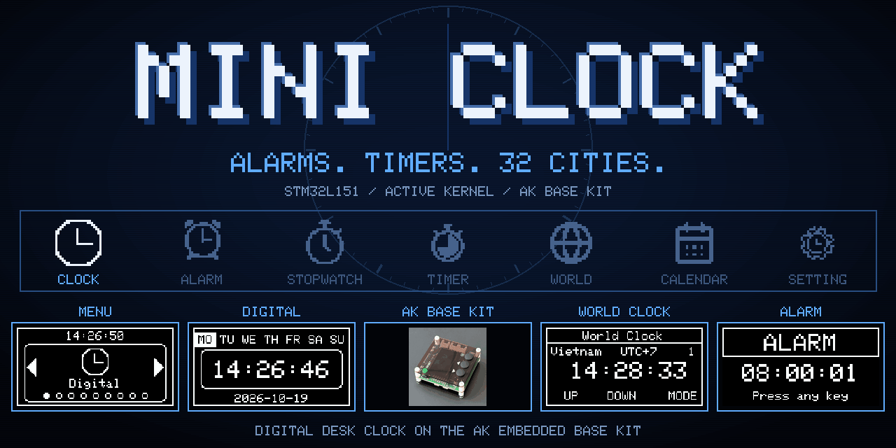
  </a>
</p>

---

## Demo

<p align="center">
  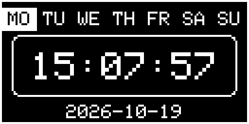
</p>

## Documentation

| File | Description |
| --- | --- |
| [README.md](README.md) | Project overview, hardware, clock features, controls, and objects. |
| [docs/01-guide-coding-rules.md](docs/01-guide-coding-rules.md) | Naming conventions, code style and clang-format setup, commit messages, and document naming. |
| [docs/02-design-sequence-object.md](docs/02-design-sequence-object.md) | Owned state and signal sequences of RTC, Time, Stopwatch, Timer, Alarm, World Clock, Calendar, and Ringing. |
| [docs/03-design-sequence-runtime.md](docs/03-design-sequence-runtime.md) | Clock start, running and ringing flows, task ownership, button processing, and scheduling notes. |

## Introduction

Mini Clock is a digital desk clock built on the AK Embedded Base Kit. It shows the time in digital and analog form, keeps alarms and calendar reminders, runs a stopwatch and a countdown timer, and converts the time to 32 world cities. Time is kept by an external RTC, and settings, alarms, and events survive a power cycle. Through this project, I practiced several embedded concepts:

- **System design:** Splitting the clock into objects with clear responsibilities.
- **Task management:** Running each object as an AK task, cooperatively and without blocking delays.
- **Communication:** Using signals, timers, and messages to carry button input, one-second ticks, and ringing requests.
- **State machine:** Managing screens and modes such as list, edit, running, and ringing.

### I. Hardware

<table align="center">
  <tr>
    <td align="center">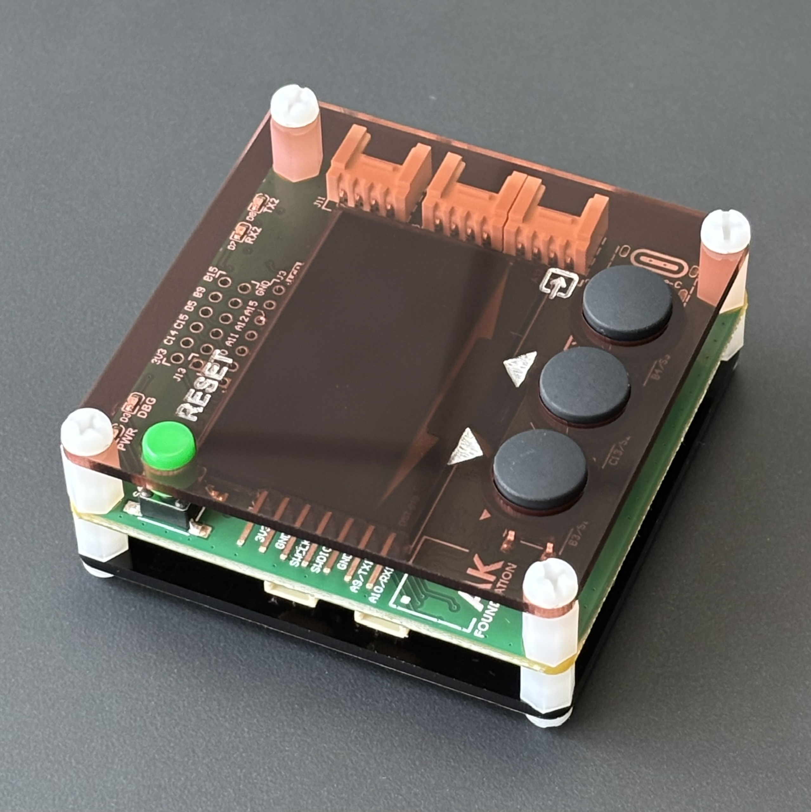</td>
  </tr>
</table>
<p align="center"><strong><em>Figure 1:</em></strong> AK Embedded Base Kit - STM32L151</p>

[AK Embedded Base Kit](https://epcb.vn/products/ak-embedded-base-kit-lap-trinh-nhung-vi-dieu-khien-mcu) is a development kit for people who already have some experience with embedded programming and want to learn more through practice.

The board includes a **1.54-inch OLED display**, **3 push buttons**, and **a buzzer** that can play simple sounds or short melodies. With these built-in parts, you can create small games, menu systems, clocks, and other interactive projects. It is also a good way to learn how **event-driven programming** works in a real embedded system.

The kit also supports **RS485**, **Qwiic**, and **Grove** connections. This makes it easy to connect sensors, modules, and other devices when testing or building embedded projects.

**MCU Overview:**

```text
SoC Name : STM32L151CBT6
RAM      : 16 KB

Flash Partitions Layout
----------------------
[ 0x08000000 - 0x08001FFF ] : Bootloader Partition (8 KB)
=> AK Bootloader

[ 0x08002000 - 0x08002FFF ] : BSF Shared Partition (4 KB)
=> Used for data sharing between Bootloader and Application

[ 0x08003000 - 0x0801FFFF ] : Application Partition (116 KB)
=> Mini Clock firmware
```

**MCU Naming Convention:**

| Part | Meaning |
|---|---|
| `STM32` | STMicroelectronics 32-bit MCU family. |
| `L` | Low-power series. |
| `151` | STM32L151 product line. |
| `C` | 48-pin package. |
| `B` | 128 KB Flash memory. |
| `T` | LQFP package. |
| `6` | Industrial temperature grade. |


<table align="center">
  <tr>
    <td align="center"></td>
  </tr>
</table>
<p align="center"><strong><em>Figure 2:</em></strong> Board view Top + Bottom </p>

**External RTC:** time is kept by a **PCF85063A** module on the Qwiic/Grove I2C port (I2C1: SCL `PB6`, SDA `PB7`, address `0x51`). The RTC holds Vietnam local time (UTC+7); other time zones are derived from it.

### II. Clock Description and Objects

This section describes the screens and objects of **Mini Clock**.

<table align="center">
  <tr>
    <td align="center">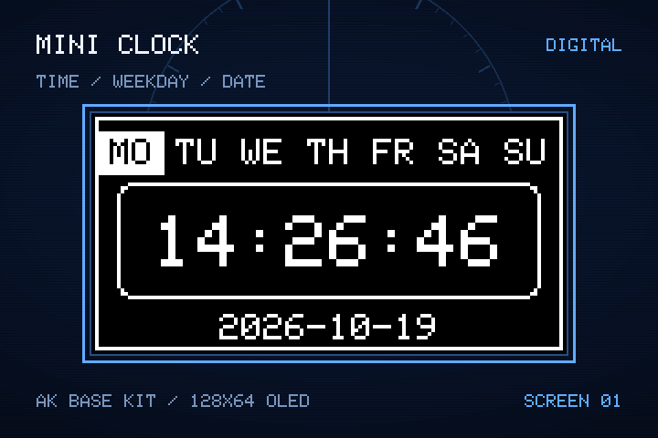</td>
  </tr>
</table>
<p align="center"><strong><em>Figure 3:</em></strong> Digital screen</p>

After the boot logo, the clock opens on the **Digital** screen. Press **[Mode]** to open the **Menu**:

<table align="center">
  <tr>
    <td align="center">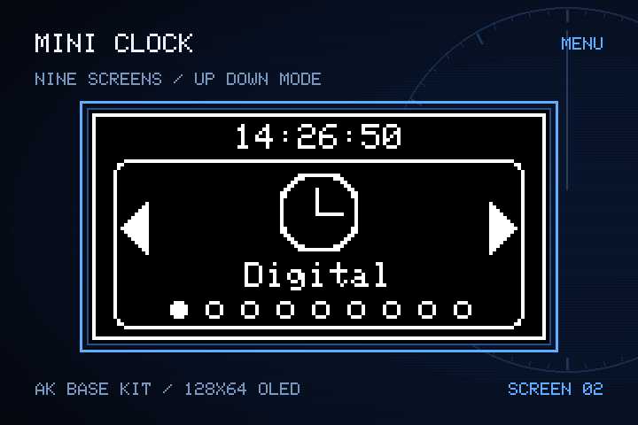</td>
  </tr>
</table>
<p align="center"><strong><em>Figure 4:</em></strong> Menu screen</p>

The menu offers:

- **Digital:** Large `HH:MM:SS`, weekday bar, and date, in 12h or 24h format.
- **Analog:** Clock face with hour, minute, and second hands, the date, and the UTC offset.
- **Alarm:** Up to 10 daily alarms, each with a time and an on/off switch.
- **Stopwatch:** 0.1 s resolution with up to 10 laps.
- **Timer:** Countdown up to 23:59:59.
- **World Clock:** 32 cities. The selected city is also the time zone shown on every other screen.
- **Calendar:** Month grid, day list, and up to 10 events with a category, start and end time, and an optional reminder.
- **Setting:** Time and date, display (12/24h, colour invert, brightness), sound (mute, hourly chime, alarm melody), and reset.
- **Exit:** Idle animation of bouncing balls.

<table align="center">
  <tr>
    <td align="center">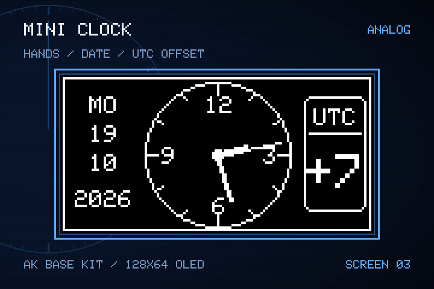</td>
  </tr>
</table>
<p align="center"><strong><em>Figure 5:</em></strong> Analog screen</p>

<table align="center">
  <tr>
    <td align="center">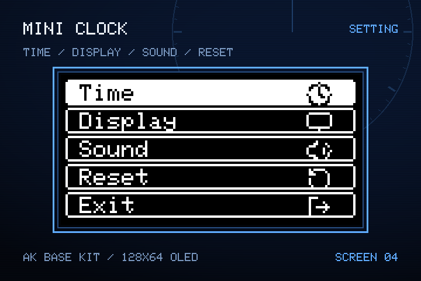</td>
  </tr>
</table>
<p align="center"><strong><em>Figure 6:</em></strong> Setting screen</p>

#### Objects in the Clock:

<div align="center">
<table>
  <thead>
    <tr>
      <th align="center">Bitmap</th>
      <th align="center">Object Name</th>
      <th align="center">Description</th>
    </tr>
  </thead>
  <tbody>
    <tr>
      <td align="center" valign="middle">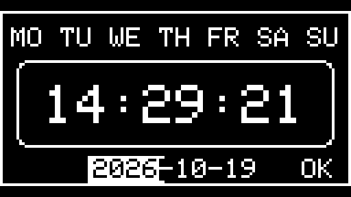</td>
      <td align="center"><strong>RTC</strong></td>
      <td>Owns the PCF85063A on I2C. Sends the one-second tick, polls the alarm flag, and retries a write the chip did not acknowledge.</td>
    </tr>
    <tr>
      <td align="center" valign="middle">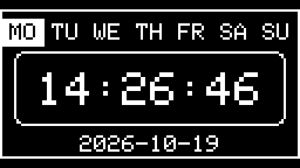</td>
      <td align="center"><strong>Time</strong></td>
      <td>Local time for the selected time zone, and the hourly chime.</td>
    </tr>
    <tr>
      <td align="center" valign="middle">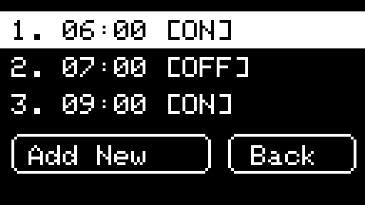</td>
      <td align="center"><strong>Alarm</strong></td>
      <td>Alarm list stored in EEPROM. Programs the next enabled alarm into the RTC.</td>
    </tr>
    <tr>
      <td align="center" valign="middle">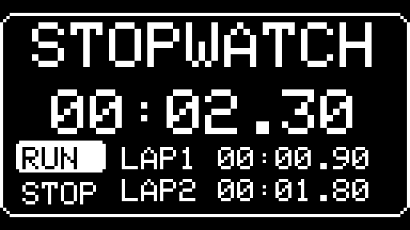</td>
      <td align="center"><strong>Stopwatch</strong></td>
      <td>Counts in 0.1 s steps on its own timer while running, and records laps.</td>
    </tr>
    <tr>
      <td align="center" valign="middle">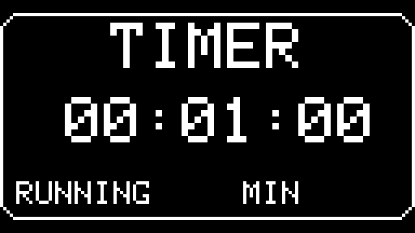</td>
      <td align="center"><strong>Timer</strong></td>
      <td>Counts down on the one-second tick and rings when it reaches zero.</td>
    </tr>
    <tr>
      <td align="center" valign="middle">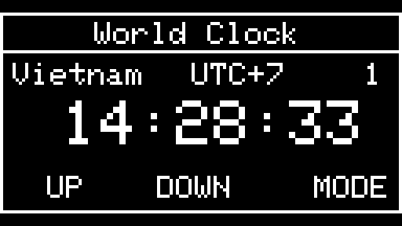</td>
      <td align="center"><strong>World Clock</strong></td>
      <td>City table and the selected time zone.</td>
    </tr>
    <tr>
      <td align="center" valign="middle">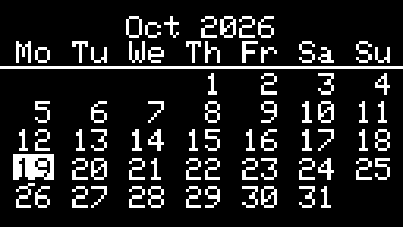</td>
      <td align="center"><strong>Calendar</strong></td>
      <td>Events stored in EEPROM. Checks reminders on the one-second tick.</td>
    </tr>
    <tr>
      <td align="center" valign="middle">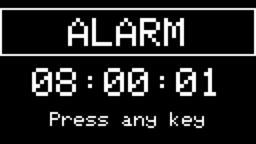</td>
      <td align="center"><strong>Ringing</strong></td>
      <td>Shared full-screen page for an alarm, a finished timer, or a calendar reminder.</td>
    </tr>
  </tbody>
</table>
</div>

> **Note:** For detailed object flows, see [Clock Object Sequences](docs/02-design-sequence-object.md).

### III. How to Use:

The kit has three buttons: **[Mode]**, **[Up]**, and **[Down]**. *Long* means hold the button; **[Mode]+[Up]** and **[Mode]+[Down]** mean press [Up] or [Down] while holding [Mode].

- **Digital / Analog:** **[Mode]** opens the menu.
- **Menu:** **[Up]** / **[Down]** choose an item, **[Mode]** opens it.
- **Alarm list:** **[Up]** / **[Down]** move, **[Mode]** edits an alarm or selects *Add New* / *Back*, long **[Up]** switches the alarm on or off, long **[Down]** deletes it, **[Mode]+[Up]** adds and edits a new alarm, **[Mode]+[Down]** returns to the menu.
- **Alarm edit:** **[Up]** / **[Down]** change the value, **[Mode]** moves to the next field. On *Delete?* it deletes the alarm, and on *Save?* it saves it.
- **Stopwatch:** **[Mode]** starts or pauses, long **[Mode]** resets, **[Up]** records a lap, **[Down]** scrolls the laps, long **[Up]** or long **[Down]** returns.
- **Timer:** **[Mode]** starts or pauses, **[Up]** / **[Down]** change the selected field, **[Mode]+[Up]** / **[Mode]+[Down]** select the next or previous field, long **[Up]** resets, long **[Down]** returns.
- **World Clock:** **[Up]** / **[Down]** change the city, **[Mode]** returns.
- **Calendar (month):** **[Up]** / **[Down]** select the previous or next day, long **[Up]** / long **[Down]** change the month, **[Mode]** opens the day, long **[Mode]** adds an event, **[Mode]+[Up]** returns to the menu.
- **Calendar (day):** **[Up]** / **[Down]** select the next or previous event (**[Down]** on an empty day adds one), **[Mode]** edits, long **[Mode]** deletes, long **[Up]** or long **[Down]** returns to the month.
- **Calendar (edit):** **[Up]** / **[Down]** change the value, **[Mode]** moves to the next field and saves on the last one, long **[Mode]** saves (or cancels a new event), long **[Down]** cancels.
- **Setting:** **[Up]** / **[Down]** move, **[Mode]** selects. In *Time*, **[Up]** / **[Down]** change a field and **[Mode]** moves on until *OK*.
- **Ringing:** any button dismisses it.

#### Clock Mechanics:

- **Time zone:** The RTC keeps Vietnam time (UTC+7). The city selected in World Clock sets the time zone of every screen, and alarms and reminders use that local time.
- **Background counting:** The timer, the stopwatch, and calendar reminders keep running when you leave their screens.
- **Ringing:** An alarm, a finished timer, or a reminder opens an **ALARM**, **TIMER**, or **EVENT** page on top of any screen. The selected alarm melody repeats every 5 seconds. Any button dismisses it, and it stops by itself after 60 seconds. A source that fires while another one is ringing replaces it.
- **Persistence:** Settings, alarms, and events are stored in EEPROM with a magic number and a checksum. An invalid record falls back to the defaults.
- **Sound:** Mute silences every sound, including the boot melody. The hourly chime plays at the start of each hour.

<table align="center">
  <tr>
    <td align="center">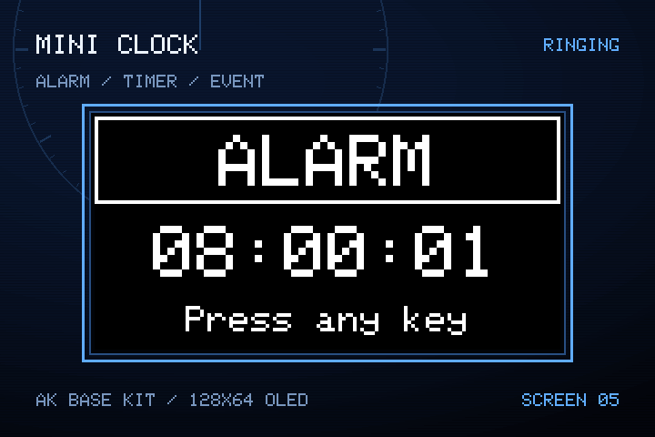</td>
  </tr>
</table>
<p align="center"><strong><em>Figure 7:</em></strong> Ringing screen</p>

### IV. Basic Clock Sequence Logic

> **Note:** For the complete signal flow, see [Runtime Signal Processing](docs/03-design-sequence-runtime.md).

<table align="center">
  <tr>
    <td align="center">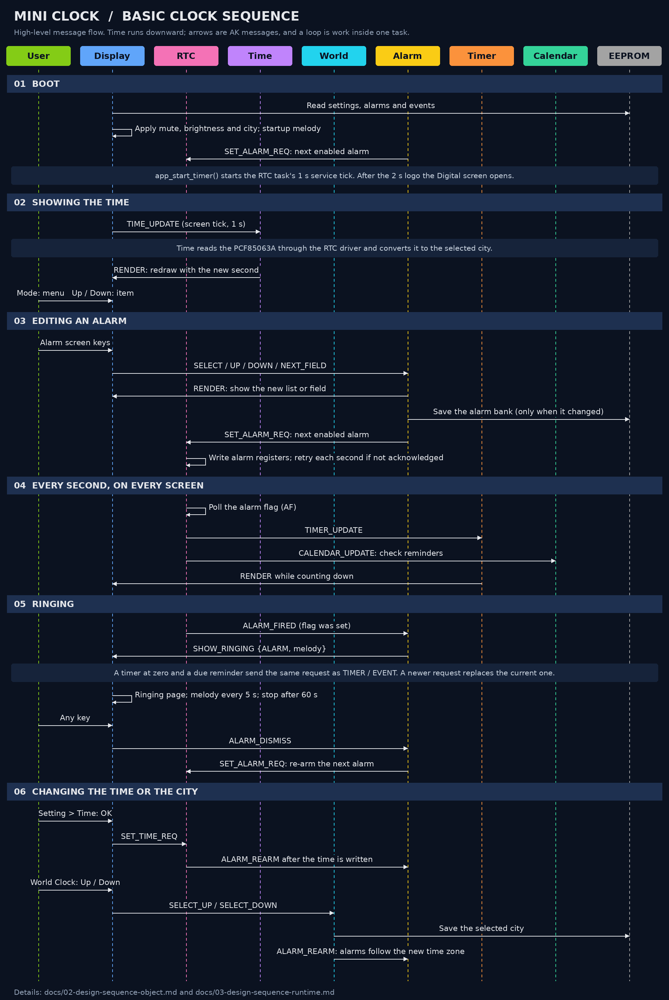</td>
  </tr>
</table>
<p align="center"><strong><em>Figure 8:</em></strong> Clock sequence logic</p>

## Contact & Support

<p style="font-size: 20px;"><strong>Cao Trong Phuoc</strong> - Software Engineer - Embedded Systems</p>

```text
Thank you for visiting this repository.
If you have any questions, suggestions, or feedback about this project or firmware development, feel free to contact me directly.
```

<a href="https://github.com/caotrongphuoc">
  
</a>

<a href="https://www.linkedin.com/in/cao-trong-phuoc/">
  
</a>

<p style="font-size: 20px;"><strong>Josef Tan</strong> - Software Engineer - Embedded Systems</p>

```text
For questions related to this project, embedded systems, or firmware development, please feel free to reach out through GitHub or LinkedIn.
```

<a href="https://github.com/joseftanlang">
  
</a>

<a href="https://www.linkedin.com/in/josef-tan/">
  
</a>
