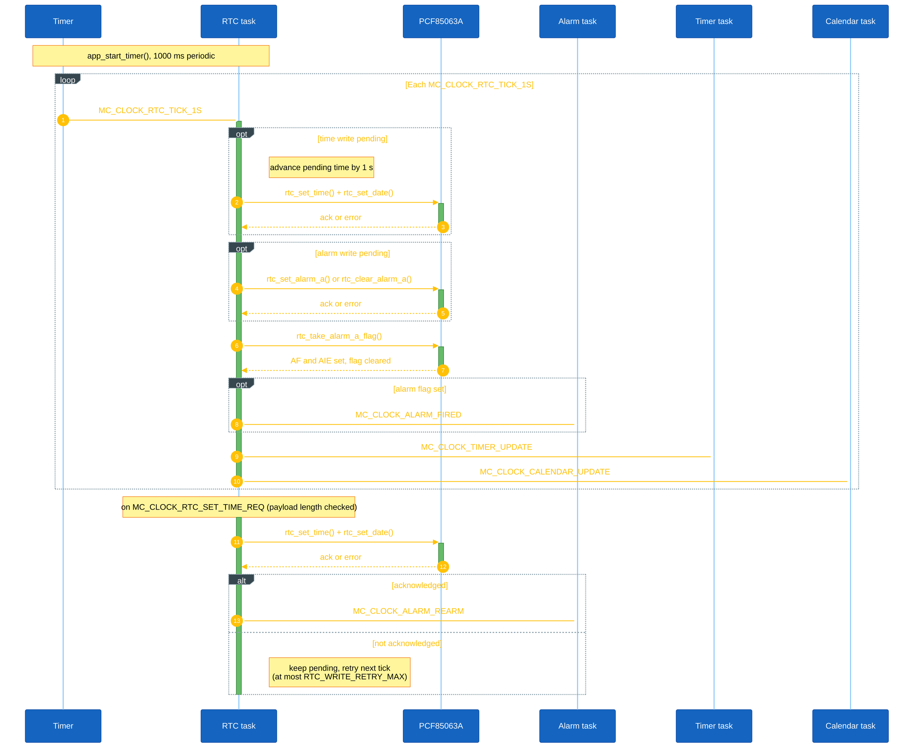
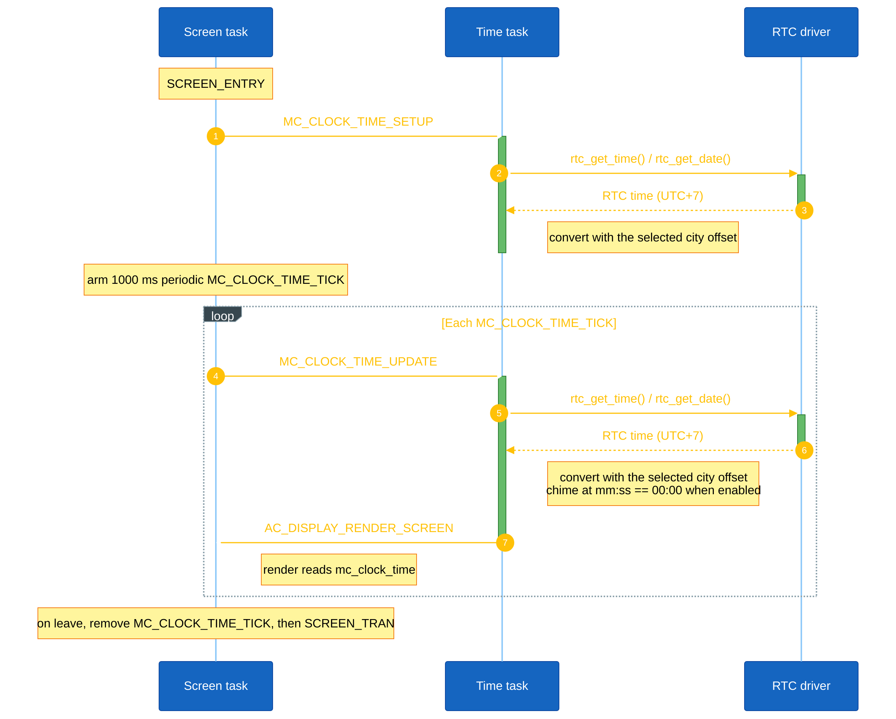
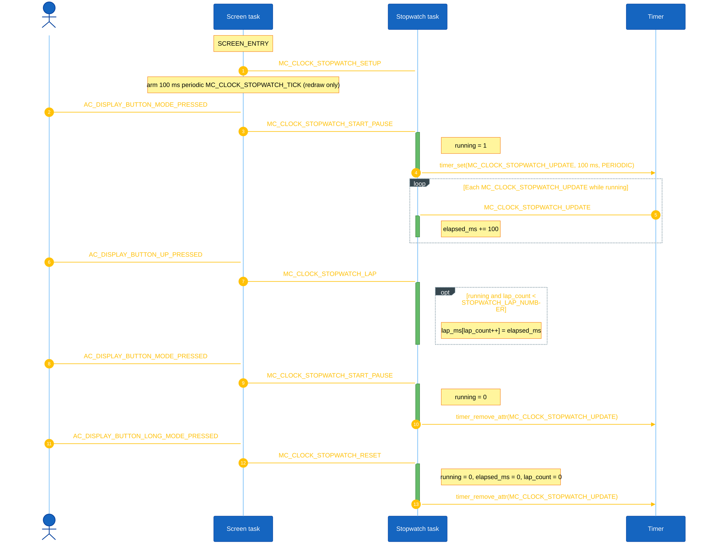
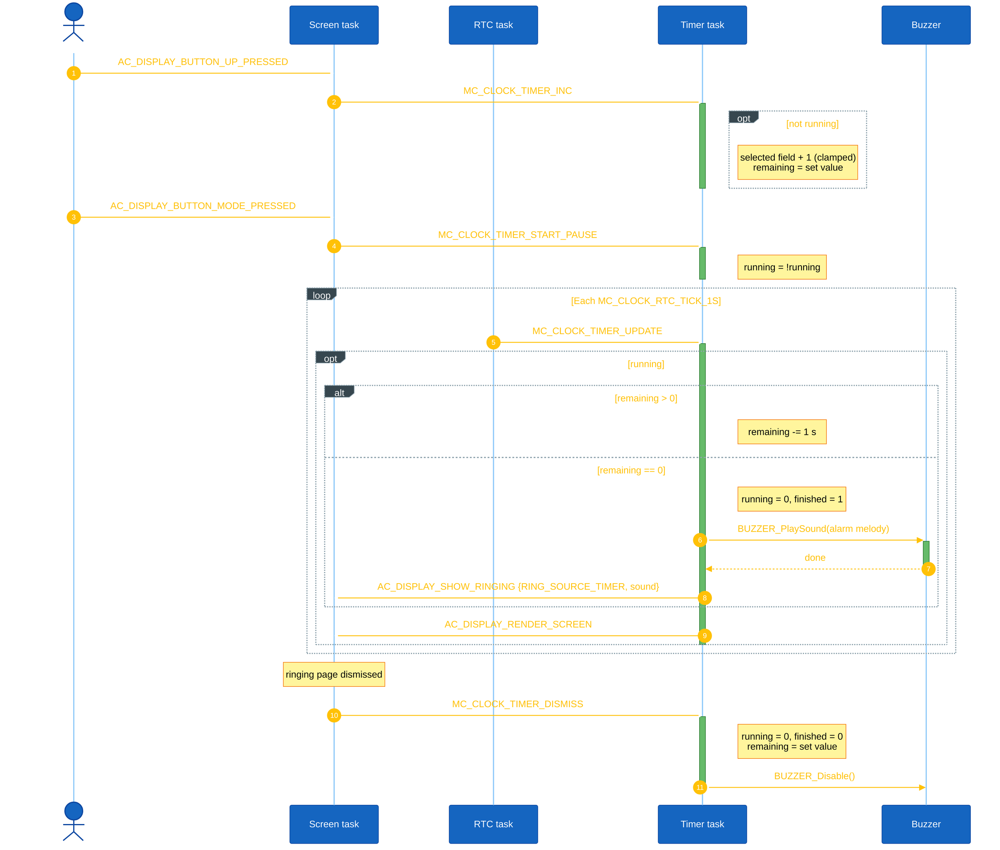
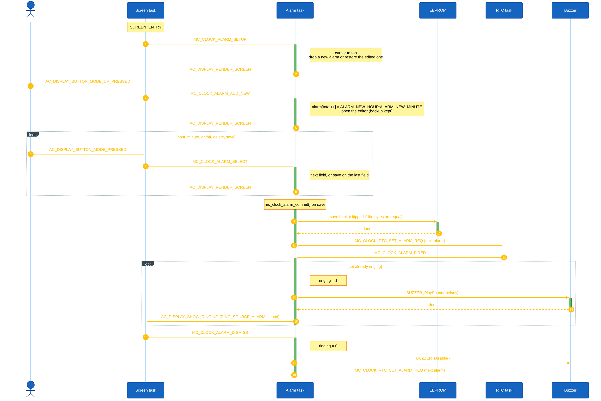
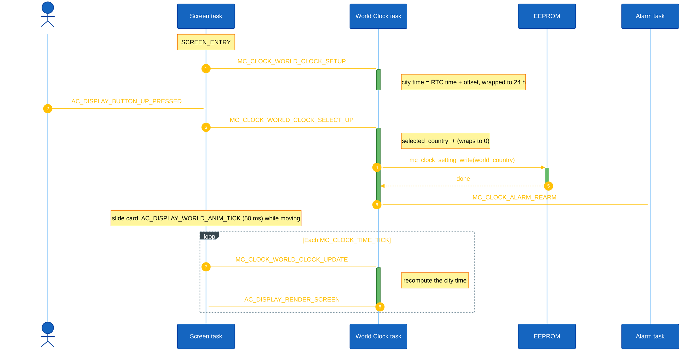
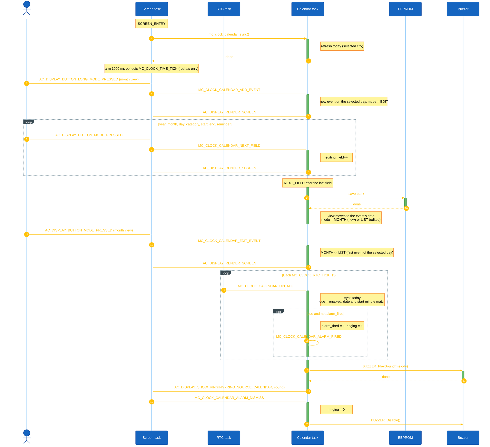
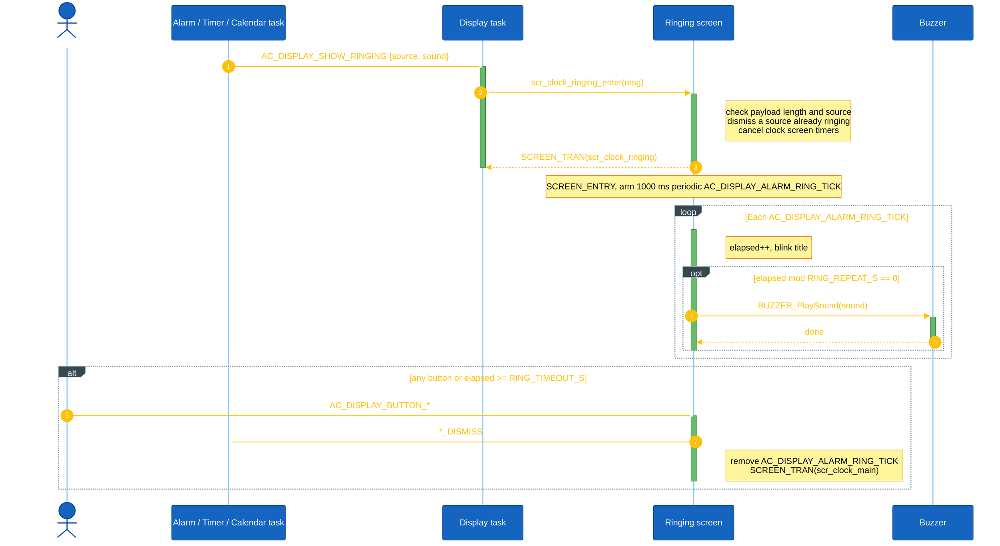

<h1 align="center">Clock Object Sequences</h1>

This document describes the runtime sequence of each main object in Mini Clock. Each object is handled by its own AK task and receives signals from the active screen on the display task, the periodic screen tick, the 1 s RTC service tick, or other object tasks.

## I. Object Summary

| Object | Task ID | Handler | Main responsibility |
|---|---|---|---|
| RTC | `MC_CLOCK_RTC_ID` | `task_mc_rtc()` | Owns every PCF85063A write, runs the 1 s service tick, polls the alarm flag, and retries writes the chip did not acknowledge. |
| Time | `MC_CLOCK_TIME_ID` | `mc_clock_time_handle()` | Local time and date of the selected city, hourly chime. |
| Stopwatch | `MC_CLOCK_STOPWATCH_ID` | `mc_clock_stopwatch_handle()` | Elapsed time in 100 ms steps and up to `STOPWATCH_LAP_NUMBER` laps. |
| Timer | `MC_CLOCK_TIMER_ID` | `mc_clock_timer_handle()` | Countdown set in hours, minutes and seconds; rings at zero. |
| Alarm | `MC_CLOCK_ALARM_ID` | `mc_clock_alarm_handle()` | Up to `ALARM_NUMBER` daily alarms, the editor, the EEPROM bank, and programming the next alarm into the RTC. |
| World Clock | `MC_CLOCK_WORLD_CLOCK_ID` | `mc_clock_world_clock_handle()` | `WORLD_CLOCK_COUNTRY_NUMBER`-city table in flash and the selected city, which is the display time zone. |
| Calendar | `MC_CLOCK_CALENDAR_ID` | `mc_clock_calendar_handle()` | Month view, day list, editor, up to `CALENDAR_EVENT_NUMBER` events in EEPROM, reminders. |
| Ringing | `AC_TASK_DISPLAY_ID` (screen) | `scr_clock_ringing_handle()` | One ringing page shared by Alarm, Timer and Calendar. |

The RTC task posts `MC_CLOCK_RTC_TICK_1S` to itself every `MC_CLOCK_RTC_TICK_1S_INTERVAL` (1000 ms) from `app_start_timer()`, on every screen. On each tick it fans out the background second to the objects that must keep running when their screen is not shown. The RTC holds Vietnam time (UTC+7); the selected World Clock city converts it for every screen, alarm and reminder.

## II. RTC Object Sequence

RTC owns the pending writes: one time/date write (`rtc_pending_time`) and one alarm write (`rtc_pending_alarm`, set or clear). Other objects never write the chip; they post a request.

**Setup.** `app_start_timer()` arms the periodic `MC_CLOCK_RTC_TICK_1S` on `MC_CLOCK_RTC_ID`.

**Input.** `MC_CLOCK_RTC_SET_TIME_REQ` (payload `mc_clock_rtc_set_time_req_t`, from the time setting screen and the `rtc s` shell command), `MC_CLOCK_RTC_SET_ALARM_REQ` (payload `mc_clock_rtc_set_alarm_req_t`) and `MC_CLOCK_RTC_CLEAR_ALARM_REQ` (both from Alarm). The payload length is checked before the payload is used. A new alarm request replaces a pending one.

**Per-tick.** Each `MC_CLOCK_RTC_TICK_1S`:

- A pending time write is advanced by one second (the retry happens one tick later) and tried again; after `RTC_WRITE_RETRY_MAX` (10) failed tries it is dropped.
- A pending alarm write is tried again, with the same limit.
- `rtc_take_alarm_a_flag()` reads and clears the alarm flag (the INT pin is not routed to an EXTI line). When the flag was set while the alarm interrupt is enabled, RTC posts `MC_CLOCK_ALARM_FIRED`.
- RTC posts `MC_CLOCK_TIMER_UPDATE` to Timer and `MC_CLOCK_CALENDAR_UPDATE` to Calendar.

**Cross-task.** A time write the chip acknowledged posts `MC_CLOCK_ALARM_REARM`, because the next alarm depends on the current time.

**Bus recovery.** The driver checks the I2C1 BUSY flag before each transfer. A stuck bus is released with nine SCL pulses and a STOP (`io_i2c1_bus_recover()` in `io_cfg.c`) and the peripheral is initialised again; after a failed transfer the driver skips the bus for 5 s and returns the last good time.

<strong><em>Figure 1:</em></strong> RTC sequence logic

## III. Time Object Sequence

Time owns the local time and date (`mc_clock_time`) and the chime flag.

**Setup.** The Digital, Analog and Menu screens post `MC_CLOCK_TIME_SETUP` on `SCREEN_ENTRY`, which reads the time once, and arm a periodic `MC_CLOCK_TIME_TICK` on the display task every `MC_CLOCK_TIME_TICK_INTERVAL` (1000 ms).

**Per-tick.** Each `MC_CLOCK_TIME_TICK` the screen posts `MC_CLOCK_TIME_UPDATE`. Time reads the RTC through the driver, converts it with the selected city's offset (`mc_clock_time_adjust_timezone()`), plays the chime at `mm:ss == 00:00` when it is enabled, and posts `AC_DISPLAY_RENDER_SCREEN`. The display rendered the tick before Time ran, so without that post the screen would show the previous second. The ringing page also posts `MC_CLOCK_TIME_UPDATE` once a second.

**Reset.** Before it switches to another screen (`SCREEN_TRAN`), the screen removes `MC_CLOCK_TIME_TICK`.

<strong><em>Figure 2:</em></strong> Time sequence logic

## IV. Stopwatch Object Sequence

Stopwatch owns `running`, `elapsed_ms`, `lap_count` and `lap_ms[STOPWATCH_LAP_NUMBER]`.

**Setup.** `MC_CLOCK_STOPWATCH_SETUP` keeps the current run; the stopwatch is not reset by leaving its screen. The screen arms its own 100 ms `MC_CLOCK_STOPWATCH_TICK`, which only redraws.

**Input.** MODE posts `MC_CLOCK_STOPWATCH_START_PAUSE`, long MODE `MC_CLOCK_STOPWATCH_RESET`, UP `MC_CLOCK_STOPWATCH_LAP`. DOWN scrolls the lap list inside the screen.

- `START_PAUSE`: toggles `running`. Starting arms a periodic `MC_CLOCK_STOPWATCH_UPDATE` on `MC_CLOCK_STOPWATCH_ID` every `MC_CLOCK_STOPWATCH_TICK_INTERVAL` (100 ms); pausing removes it.
- `LAP`: stores `elapsed_ms` in the next slot, only while running and while `lap_count < STOPWATCH_LAP_NUMBER`.
- `RESET`: stops, removes the update timer, and clears `elapsed_ms` and the laps.

**Per-tick.** Each `MC_CLOCK_STOPWATCH_UPDATE` adds 100 ms to `elapsed_ms`. The timer belongs to the Stopwatch task, so counting continues on any screen.

<strong><em>Figure 3:</em></strong> Stopwatch sequence logic

## V. Timer Object Sequence

Timer owns the set value, the remaining value, `running`, `finished` and the selected field (`TIMER_EDIT_HOUR`, `TIMER_EDIT_MIN`, `TIMER_EDIT_SEC`).

**Setup.** `MC_CLOCK_TIMER_SETUP` keeps the current countdown. The screen arms its own 1000 ms `MC_CLOCK_TIMER_TICK`, which only redraws and times out the help hint.

**Input.** UP/DOWN post `MC_CLOCK_TIMER_INC` / `MC_CLOCK_TIMER_DEC` for the selected field (hour up to `TIMER_HOUR_MAX`, minute and second up to 59), MODE+UP/MODE+DOWN `MC_CLOCK_TIMER_NEXT_FIELD` / `MC_CLOCK_TIMER_PREV_FIELD`, MODE or long MODE `MC_CLOCK_TIMER_START_PAUSE`, long UP `MC_CLOCK_TIMER_RESET`. While the timer has finished, MODE, UP and DOWN post `MC_CLOCK_TIMER_DISMISS` instead. Editing is ignored while running. Starting from zero reloads the set value first.

**Per-tick.** The countdown runs on the RTC task's `MC_CLOCK_TIMER_UPDATE`, so it continues on any screen. While running, each update removes one second and posts `AC_DISPLAY_RENDER_SCREEN`. At zero the timer stops, sets `finished`, plays the selected alarm melody and calls `mc_clock_ring_request(RING_SOURCE_TIMER, sound)`.

**Reset.** `MC_CLOCK_TIMER_DISMISS` (from the ringing page) and `MC_CLOCK_TIMER_RESET` stop the countdown, silence the buzzer and reload the set value.

<strong><em>Figure 4:</em></strong> Timer sequence logic

## VI. Alarm Object Sequence

Alarm owns the list (`total_alarm`, `alarm[ALARM_NUMBER]` with hour, minute and enabled), the list cursor and scroll offset (`ALARM_LIST_VISIBLE` rows), the editor state, a backup of the alarm being edited, the ringing flag and the selected melody.

**Setup.** At boot the startup screen calls `mc_clock_alarm_load_from_eeprom()` on `AC_DISPLAY_INITIAL`, which reads the bank at `0x0100` (magic and checksum checked) and programs the RTC. `MC_CLOCK_ALARM_SETUP` (posted on `SCREEN_ENTRY`) moves the cursor to the top and discards an unfinished edit: a new alarm is dropped and an edited one is restored from the backup.

**Input.** The Alarm screen posts one signal per button:

- `SELECT` (MODE): opens the selected alarm in the editor, adds an alarm at `ALARM_NEW_HOUR:ALARM_NEW_MINUTE` on "Add New", or in the editor moves to the next field, deletes, or saves.
- `UP` / `DOWN`: moves the cursor, or changes the selected field in the editor.
- `NEXT_FIELD` (long MODE): next field; on the last field it saves.
- `ADD_NEW` (MODE+UP): adds an alarm and opens it in the editor; it is kept only when the edit is saved.
- `TOGGLE` (long UP) and `DELETE` (long DOWN): turn the selected alarm on or off, or delete it.

A change to the list (add, delete, on/off, saved edit) goes through `mc_clock_alarm_commit()`: it re-arms the RTC and saves the bank, skipping the write when EEPROM already holds the same bytes. After each of these signals Alarm posts `AC_DISPLAY_RENDER_SCREEN`, because the Alarm screen has no periodic tick.

**Cross-task.** `mc_clock_alarm_apply_rtc()` picks the enabled alarm closest after the current time, converts it from the selected city to RTC time, and posts `MC_CLOCK_RTC_SET_ALARM_REQ`, or `MC_CLOCK_RTC_CLEAR_ALARM_REQ` when none is enabled. RTC and World Clock request this with `MC_CLOCK_ALARM_REARM` after the time or the city changes.

**Ringing.** `MC_CLOCK_ALARM_FIRED` (from RTC) sets `ringing`, plays the melody and calls `mc_clock_ring_request(RING_SOURCE_ALARM, sound)`, unless an alarm is already ringing. `MC_CLOCK_ALARM_DISMISS` (from the ringing page) clears `ringing`, silences the buzzer and arms the next alarm.

<strong><em>Figure 5:</em></strong> Alarm sequence logic

## VII. World Clock Object Sequence

World Clock owns `selected_country` and the converted time. The city table (`world_clock_country[WORLD_CLOCK_COUNTRY_NUMBER]`, name, offset in minutes from UTC+7, UTC label) is `static const` in flash.

**Setup.** At boot the startup screen restores the city saved in the settings record (`0x0010`) with `mc_clock_world_clock_select_country()`. `MC_CLOCK_WORLD_CLOCK_SETUP` (on `SCREEN_ENTRY`) computes the city time once.

**Input.** UP/DOWN post `MC_CLOCK_WORLD_CLOCK_SELECT_UP` / `MC_CLOCK_WORLD_CLOCK_SELECT_DOWN`, which wrap around the table. Each change saves the city in the settings record and posts `MC_CLOCK_ALARM_REARM`, because alarms are stored in local time. The screen slides the city card with a 50 ms `AC_DISPLAY_WORLD_ANIM_TICK` that runs only while the card moves.

**Per-tick.** Each `MC_CLOCK_TIME_TICK` the screen posts `MC_CLOCK_WORLD_CLOCK_UPDATE`; World Clock recomputes the city time and posts `AC_DISPLAY_RENDER_SCREEN`.

<strong><em>Figure 6:</em></strong> World Clock sequence logic

## VIII. Calendar Object Sequence

Calendar owns today, the viewed month and selected day, the mode (`CALENDAR_MODE_MONTH`, `CALENDAR_MODE_LIST`, `CALENDAR_MODE_EDIT`), the list cursor, the event being edited and its backup, the ringing flag and `events[CALENDAR_EVENT_NUMBER]`.

**Setup.** At boot the startup screen calls `mc_clock_calendar_load_from_eeprom()`, which reads the bank at `0x0200` (magic and checksum checked). `mc_clock_calendar_init()` opens the month view on today. On `SCREEN_ENTRY` the screen calls `mc_clock_calendar_sync()` to refresh today and arms `MC_CLOCK_TIME_TICK` (1000 ms, redraw only); the view keeps its month, day and mode. `MC_CLOCK_CALENDAR_SETUP` (long UP in the day list) returns to the month view and clears the list and editor state.

**Input.** The Calendar screen maps each button to a signal by mode:

| Button | Month view | Day list | Editor |
|---|---|---|---|
| UP / DOWN | `FIELD_DEC` / `FIELD_INC` (previous / next day, across month edges) | `FIELD_INC` / `FIELD_DEC` (walk the day's events) | `FIELD_INC` / `FIELD_DEC` (change the field) |
| MODE | `EDIT_EVENT` (open the day list) | `EDIT_EVENT` (edit the selected event) | `NEXT_FIELD` |
| Long MODE | `ADD_EVENT` | `DELETE_EVENT` | `NEXT_FIELD` up to the last field (finish), or `DELETE_EVENT` for an unsaved new event |
| Long UP | `PREV_MONTH` | `SETUP` (back to the month view) | |
| Long DOWN | `NEXT_MONTH` | `BACK` | `BACK` |

- `ADD_EVENT` adds an event on the selected day from `CALENDAR_NEW_START_HOUR` to `CALENDAR_NEW_END_HOUR` and opens the editor.
- The day list walks only the selected day's events, `CALENDAR_LIST_VISIBLE` at a time, so the cursor never selects a hidden event.
- `NEXT_FIELD` walks year, month, day, category, start, end and reminder. After the last field the bank is saved and the view moves to the event's date (month view for a new event, day list for an edited one).
- `BACK` from the editor drops an unsaved new event or restores the edited one from the backup.
- `DELETE_EVENT` removes the event, selects the next event of the same day, and saves the bank.

Every button-driven signal posts `AC_DISPLAY_RENDER_SCREEN`.

**Per-tick.** On each `MC_CLOCK_CALENDAR_UPDATE` from the RTC task Calendar syncs today and checks reminders: an event with `alarm_enabled` whose date and start minute match the local time rings once. `alarm_fired` latches until the minute passes; the whole minute is matched because a 1 s tick can skip second 0. A due event posts `MC_CLOCK_CALENDAR_ALARM_FIRED` to Calendar itself, which plays the melody and calls `mc_clock_ring_request(RING_SOURCE_CALENDAR, sound)`.

**Reset.** `MC_CLOCK_CALENDAR_ALARM_DISMISS` (from the ringing page) clears `ringing` and silences the buzzer.

<strong><em>Figure 7:</em></strong> Calendar sequence logic

## IX. Ringing Object Sequence

Ringing owns the source that is ringing (`ringing_source`), its melody, the elapsed seconds and the blink flag. It exposes no task: Alarm, Timer and Calendar call `mc_clock_ring_request(source, sound)` (`mc_clock_ring.h`), which posts `AC_DISPLAY_SHOW_RINGING` with an `mc_clock_ring_req_t {source, sound}` to the display task.

**Setup.** `task_display` handles `AC_DISPLAY_SHOW_RINGING` before the active screen does and calls `scr_clock_ringing_enter()`. It checks the payload length and the source, dismisses a source that is already ringing, cancels every periodic display timer a clock screen may own (the interrupted screen does not get to clean up), and switches to the ringing page. `SCREEN_ENTRY` arms `AC_DISPLAY_ALARM_RING_TICK` every `AC_DISPLAY_ALARM_RING_TICK_INTERVAL` (1000 ms).

**Per-tick.** Each `AC_DISPLAY_ALARM_RING_TICK` blinks the title bar, posts `MC_CLOCK_TIME_UPDATE` for the time line, and replays the melody every `RING_REPEAT_S` (5 s).

**Reset.** Any button, or `RING_TIMEOUT_S` (60 s), posts the source's dismiss signal (`MC_CLOCK_ALARM_DISMISS`, `MC_CLOCK_TIMER_DISMISS` or `MC_CLOCK_CALENDAR_ALARM_DISMISS`), removes the ring tick and returns to the Digital screen.

<strong><em>Figure 8:</em></strong> Ringing sequence logic

## X. Per-Second Signal Order

The RTC task posts the following sequence on every `MC_CLOCK_RTC_TICK_1S`, on every screen:

1. Retry of a pending time write (`rtc_set_time()` + `rtc_set_date()`), then `MC_CLOCK_ALARM_REARM` when it is acknowledged
2. Retry of a pending alarm write (`rtc_set_alarm_a()` or `rtc_clear_alarm_a()`)
3. `MC_CLOCK_ALARM_FIRED` (only when the alarm flag was set)
4. `MC_CLOCK_TIMER_UPDATE`
5. `MC_CLOCK_CALENDAR_UPDATE`

The active screen adds its own periodic tick on the display task: `MC_CLOCK_TIME_TICK` (1000 ms, Digital, Analog, Menu, Calendar, World Clock), `MC_CLOCK_STOPWATCH_TICK` (100 ms), `MC_CLOCK_TIMER_TICK` (1000 ms) or `AC_DISPLAY_ALARM_RING_TICK` (1000 ms, ringing page). On `SCREEN_ENTRY` each clock screen posts its object's `*_SETUP` signal (Calendar calls `mc_clock_calendar_sync()` instead) and arms its tick; before `SCREEN_TRAN` to another screen it removes the tick. These tick signals are the first value of their blocks, so `MC_CLOCK_TIME_TICK`, `MC_CLOCK_STOPWATCH_TICK` and `MC_CLOCK_TIMER_TICK` share one value (`MC_CLOCK_DEFINE_SIG`) on the display task, and removing one removes whichever is armed.

## XI. Persistence

| Record | Address | Owner | Written when |
|---|---|---|---|
| Settings | `0x0010` | Setting screens, World Clock, `mute` shell command | A setting or the city changes. |
| Alarm bank | `0x0100` | Alarm | The list changes; skipped when the stored bytes are equal. |
| Calendar bank | `0x0200` | Calendar | An event is saved or deleted. |

Each record is `MC_CLOCK_EEPROM_MAGIC_NUMBER` (`0x6D63636B`, "mcck") + data + an 8-bit sum. An invalid record falls back to the defaults (24 h, sound on, Vietnam, brightness HIGH, empty alarm list, empty calendar).

## XII. Code References

| Object | Source file | Header file |
|---|---|---|
| RTC | `application/sources/app/task_mc_rtc.cpp` | `application/sources/app/task_mc_rtc.h` |
| RTC driver | `application/sources/driver/rtc/rtc.cpp` | `application/sources/driver/rtc/rtc.h` |
| Time | `application/sources/app/mini_clock/mc_clock_time.cpp` | `application/sources/app/mini_clock/mc_clock_time.h` |
| Stopwatch | `application/sources/app/mini_clock/mc_clock_stopwatch.cpp` | `application/sources/app/mini_clock/mc_clock_stopwatch.h` |
| Timer | `application/sources/app/mini_clock/mc_clock_timer.cpp` | `application/sources/app/mini_clock/mc_clock_timer.h` |
| Alarm | `application/sources/app/mini_clock/mc_clock_alarm.cpp` | `application/sources/app/mini_clock/mc_clock_alarm.h` |
| World Clock | `application/sources/app/mini_clock/mc_clock_world.cpp` | `application/sources/app/mini_clock/mc_clock_world.h` |
| Calendar | `application/sources/app/mini_clock/mc_clock_calendar.cpp` | `application/sources/app/mini_clock/mc_clock_calendar.h` |
| Ringing | `application/sources/app/screens/scr_clock_ringing.cpp` | `application/sources/app/mini_clock/mc_clock_ring.h`, `application/sources/app/screens/scr_clock_ringing.h` |
| Date helpers | (header only) | `application/sources/app/mini_clock/mc_clock_date.h` |
| EEPROM records | `application/sources/app/app_eeprom.cpp` | `application/sources/app/app_eeprom.h` |
