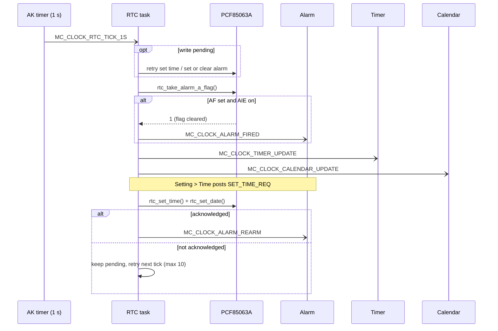
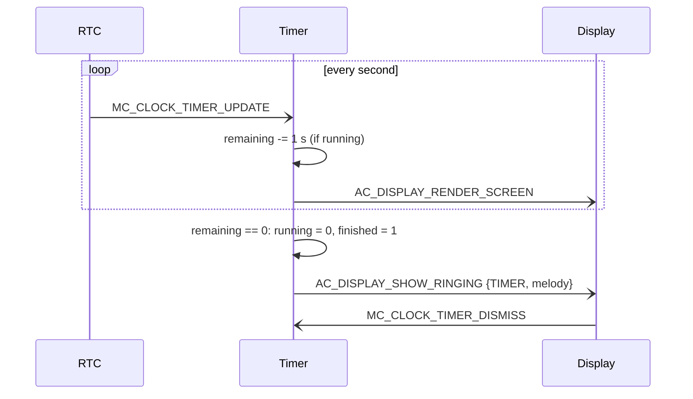
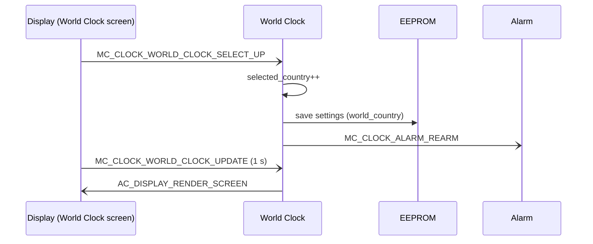

<h1 align="center">Clock Object Sequences</h1>

This document describes each Mini Clock object's owned state, inputs, periodic work, outgoing
messages, and persistence. Every object is an AK task that keeps its state `static` in its own
`.cpp` file, exposes a copy-out `mc_clock_<object>_get_state()` snapshot for rendering, and
changes state only when it handles one of its own signals. The Display task runs the active
screen; it translates button events into object signals and renders the snapshots.

In the diagrams, `-)` is an asynchronous AK message (`task_post_*` or a timer expiry) and `->>` is
a call inside one task or into a driver. Posting a message does not run the receiver
immediately: the RTC task (priority 5) runs before the clock objects and Display (priority 4).

## I. Object Summary

| Object | Task ID | Handler | Main responsibility |
|---|---|---|---|
| RTC | `MC_CLOCK_RTC_ID` | `task_mc_rtc()` | Own every PCF85063A write, run the 1 s service tick, poll the alarm flag, retry writes the chip did not acknowledge. |
| Time | `MC_CLOCK_TIME_ID` | `mc_clock_time_handle()` | Local time and date for the selected city; hourly chime. |
| Stopwatch | `MC_CLOCK_STOPWATCH_ID` | `mc_clock_stopwatch_handle()` | Elapsed time in 100 ms steps and up to 10 laps. |
| Timer | `MC_CLOCK_TIMER_ID` | `mc_clock_timer_handle()` | Countdown set in hours, minutes and seconds; rings at zero. |
| Alarm | `MC_CLOCK_ALARM_ID` | `mc_clock_alarm_handle()` | Up to 10 daily alarms, the editor, the EEPROM bank, and programming the next alarm into the RTC. |
| World Clock | `MC_CLOCK_WORLD_CLOCK_ID` | `mc_clock_world_clock_handle()` | 32-city table in flash and the selected city, which is the display time zone. |
| Calendar | `MC_CLOCK_CALENDAR_ID` | `mc_clock_calendar_handle()` | Month view, day list, editor, up to 10 events in EEPROM, reminders. |
| Ringing | none; Display screen | `scr_clock_ringing_handle()` | Shared ringing page for Alarm, Timer and Calendar. |

The RTC holds Vietnam time (UTC+7). World Clock offsets are minutes relative to UTC+7, and the
selected city converts the RTC time for every screen, alarm and reminder.

## II. RTC Object Sequence

The RTC task owns the pending write requests: one time/date write and one alarm write
(set or clear). Other objects never write the chip; they post a request.

**Service tick.** `app_start_timer()` starts a periodic `MC_CLOCK_RTC_TICK_1S` every 1000 ms. On
each tick the task retries any pending write, polls the alarm flag with
`rtc_take_alarm_a_flag()` (the INT pin is not routed to an EXTI line), and posts the background
second to Timer and Calendar.

**Requests.** `MC_CLOCK_RTC_SET_TIME_REQ` (payload `mc_clock_rtc_set_time_req_t`),
`MC_CLOCK_RTC_SET_ALARM_REQ` (`mc_clock_rtc_set_alarm_req_t`) and `MC_CLOCK_RTC_CLEAR_ALARM_REQ`.
Payload lengths are checked before use. A write the RTC did not acknowledge stays pending and is
retried on every tick, at most 10 times; a pending time is advanced by one second per retry so the
clock is not left behind. A new alarm request replaces a pending one.

**Bus recovery.** The driver checks the I2C1 BUSY flag before each transfer. A stuck bus is
released with nine SCL pulses and a STOP (`io_i2c1_bus_recover()` in `io_cfg.c`) and the
peripheral is re-initialised; after a failed transfer the driver skips the bus for 5 s and
returns the last good time.



## III. Time Object Sequence

Time owns `clock_state` (local time and date) and the chime flag.

**Inputs.** The Digital, Analog and Menu screens set a periodic `MC_CLOCK_TIME_TICK` on Display
(1000 ms) and forward each tick as `MC_CLOCK_TIME_UPDATE`. `MC_CLOCK_TIME_SETUP` reads the time
once on screen entry. The ringing page also posts `MC_CLOCK_TIME_UPDATE` each second.

**Update.** Time reads the RTC through the driver, converts it with the selected city's offset
(`mc_clock_time_adjust_timezone()`), plays the chime at `mm:ss == 00:00` when enabled, and posts
`AC_DISPLAY_RENDER_SCREEN` so the screen redraws with the new second. Without that post the screen
would show the value from before the update, one second late.

```mermaid
sequenceDiagram
    participant Display as Display (Digital screen)
    participant Time
    participant Driver as RTC driver

    Display-)Display: MC_CLOCK_TIME_TICK (1000 ms)
    Display-)Time: MC_CLOCK_TIME_UPDATE
    Time->>Driver: rtc_get_time() / rtc_get_date()
    Time->>Time: apply the city offset; chime at the hour
    Time-)Display: AC_DISPLAY_RENDER_SCREEN
    Display->>Time: mc_clock_time_get_state() for the view
```

## IV. Stopwatch Object Sequence

Stopwatch owns `running`, `elapsed_ms`, `lap_count` and `lap_ms[10]`.

**Inputs.** Mode posts `MC_CLOCK_STOPWATCH_START_PAUSE`, long Mode `MC_CLOCK_STOPWATCH_RESET`, Up
`MC_CLOCK_STOPWATCH_LAP` (only while running, up to 10 laps). Down scrolls the lap list inside the
screen.

**Update.** Starting sets the stopwatch's own periodic timer, `MC_CLOCK_STOPWATCH_UPDATE` every
100 ms on `MC_CLOCK_STOPWATCH_ID`; pausing and reset remove it. Counting therefore continues when
the screen is left. The screen's own 100 ms `MC_CLOCK_STOPWATCH_TICK` only redraws.

```mermaid
sequenceDiagram
    participant Display as Display (Stopwatch screen)
    participant Stopwatch

    Display-)Stopwatch: MC_CLOCK_STOPWATCH_START_PAUSE
    Stopwatch->>Stopwatch: running = 1; timer_set(UPDATE, 100 ms, periodic)
    loop every 100 ms while running
        Stopwatch-)Stopwatch: MC_CLOCK_STOPWATCH_UPDATE (elapsed += 100)
    end
    Display-)Stopwatch: MC_CLOCK_STOPWATCH_LAP
    Display-)Stopwatch: MC_CLOCK_STOPWATCH_START_PAUSE
    Stopwatch->>Stopwatch: running = 0; timer_remove_attr(UPDATE)
```

## V. Timer Object Sequence

Timer owns the set value, the remaining value, `running`, `finished` and the selected field.

**Inputs.** Up/Down post `MC_CLOCK_TIMER_INC` / `MC_CLOCK_TIMER_DEC` for the selected field,
Mode+Up/Mode+Down `MC_CLOCK_TIMER_NEXT_FIELD` / `MC_CLOCK_TIMER_PREV_FIELD`, Mode
`MC_CLOCK_TIMER_START_PAUSE`, long Up `MC_CLOCK_TIMER_RESET`. Editing is ignored while running.

**Update.** The countdown runs on the RTC task's `MC_CLOCK_TIMER_UPDATE`, so it continues on any
screen. While running, each update posts `AC_DISPLAY_RENDER_SCREEN`. At zero the timer stops,
plays the alarm melody and calls `mc_clock_ring_request(MC_CLOCK_RING_SOURCE_TIMER, ...)`.
`MC_CLOCK_TIMER_DISMISS` (from the ringing page) silences the buzzer and reloads the set value.



## VI. Alarm Object Sequence

Alarm owns the list (`total_alarm`, `alarm[10]` with hour, minute, enabled), the list cursor and
scroll offset, the editor state, a backup of the alarm being edited, the ringing flag and the
selected melody.

**Setup.** At boot `mc_clock_alarm_load_from_eeprom()` reads the bank at `0x0100` (magic and
checksum checked) and programs the RTC. `MC_CLOCK_ALARM_SETUP` (posted on screen entry) moves the
cursor to the top and discards an unfinished edit: a new alarm is dropped and an existing one is
restored from the backup.

**List and editor.** `SELECT`, `UP`, `DOWN`, `NEXT_FIELD`, `TOGGLE`, `DELETE` and `ADD_NEW` change
the list or the editor. A change to the list (add, delete, on/off, saved edit) re-arms the RTC and
saves the bank; the save is skipped when EEPROM already holds the same bytes. After any of these
signals Alarm posts `AC_DISPLAY_RENDER_SCREEN`, because the Alarm screen has no periodic tick.

**Arming.** `mc_clock_alarm_apply_rtc()` (private) picks the enabled alarm closest after the
current time, converts it from the selected city to RTC time, and posts
`MC_CLOCK_RTC_SET_ALARM_REQ`, or `MC_CLOCK_RTC_CLEAR_ALARM_REQ` when none is enabled. Other
objects request this with `MC_CLOCK_ALARM_REARM` after the time or the city changes.

```mermaid
sequenceDiagram
    participant Display as Display (Alarm screen)
    participant Alarm
    participant EEPROM
    participant RTC

    Display-)Alarm: MC_CLOCK_ALARM_SETUP (screen entry)
    Display-)Alarm: MC_CLOCK_ALARM_SELECT (edit) ... NEXT_FIELD (save)
    Alarm-)Display: AC_DISPLAY_RENDER_SCREEN
    Alarm->>EEPROM: save bank (skipped if unchanged)
    Alarm-)RTC: MC_CLOCK_RTC_SET_ALARM_REQ {next alarm}

    RTC-)Alarm: MC_CLOCK_ALARM_FIRED
    alt not already ringing
        Alarm->>Alarm: ringing = 1; play melody
        Alarm-)Display: AC_DISPLAY_SHOW_RINGING {ALARM, melody}
    end
    Display-)Alarm: MC_CLOCK_ALARM_DISMISS
    Alarm->>Alarm: ringing = 0; buzzer off
    Alarm-)RTC: MC_CLOCK_RTC_SET_ALARM_REQ {next alarm}
```

## VII. World Clock Object Sequence

World Clock owns `selected_country` and the converted time; the 32-city table
(`world_clock_country[]`) is `static const` in flash.

**Inputs.** Up/Down post `MC_CLOCK_WORLD_CLOCK_SELECT_UP` / `SELECT_DOWN`. Each change saves the
city in the settings record (`0x0010`) and posts `MC_CLOCK_ALARM_REARM`, because alarms are stored
in local time. `MC_CLOCK_WORLD_CLOCK_UPDATE` (1 s screen tick) recomputes the city time and posts
`AC_DISPLAY_RENDER_SCREEN`. The 50 ms `AC_DISPLAY_WORLD_ANIM_TICK` runs only while the card slides.



## VIII. Calendar Object Sequence

Calendar owns today, the viewed month and selected day, the mode (month, day list, editor), the
list cursor, the event being edited and its backup, the ringing flag and `events[10]`.

**Navigation.** The day list only walks events of the selected day, two at a time, so the cursor
never selects a hidden event. Stepping before the 1st selects the last day of the previous month.
Back from the editor drops an unsaved new event or restores the edited one. Finishing an edit saves
the bank at `0x0200` and moves the view to the event's date. Button-driven signals post
`AC_DISPLAY_RENDER_SCREEN`.

**Reminders.** On each `MC_CLOCK_CALENDAR_UPDATE` from the RTC task, an event with
`alarm_enabled` whose date and start minute match the local time rings once
(`alarm_fired` latches until the minute passes). The whole minute is matched because the 1 s tick
can skip second 0.

```mermaid
sequenceDiagram
    participant RTC
    participant Calendar
    participant Display

    RTC-)Calendar: MC_CLOCK_CALENDAR_UPDATE
    Calendar->>Calendar: today; due = enabled and date and start minute match
    alt due and not alarm_fired
        Calendar->>Calendar: alarm_fired = 1; ringing = 1
        Calendar-)Calendar: MC_CLOCK_CALENDAR_ALARM_FIRED
        Calendar-)Display: AC_DISPLAY_SHOW_RINGING {EVENT, melody}
    end
    Display-)Calendar: MC_CLOCK_CALENDAR_ALARM_DISMISS
```

## IX. Ringing Sequence

`mc_clock_ring_request()` (`mini_clock/mc_clock_ring.h`) posts `AC_DISPLAY_SHOW_RINGING` with an
`mc_clock_ring_req_t {source, sound}`. `task_display` handles it before the active screen does:
`scr_clock_ringing_enter()` checks the payload length, dismisses a source that is already ringing,
cancels every periodic display timer a clock screen may own, and switches to the ringing page. The
page blinks its title each second, replays the melody every 5 s, and after 60 s or any key posts the
source's dismiss signal and returns to the Digital screen.

```mermaid
sequenceDiagram
    participant Source as Alarm / Timer / Calendar
    participant Display
    participant Page as scr_clock_ringing

    Source-)Display: AC_DISPLAY_SHOW_RINGING {source, sound}
    Display->>Page: scr_clock_ringing_enter(): cancel screen timers, SCREEN_TRAN
    loop every 1 s (AC_DISPLAY_ALARM_RING_TICK)
        Page->>Page: blink; melody every 5 s
    end
    alt any key or 60 s
        Page-)Source: *_DISMISS
        Page->>Display: SCREEN_TRAN to Digital
    end
```

## X. Persistence

| Record | Address | Owner | Written when |
|---|---|---|---|
| Settings | `0x0010` | Setting screens, World Clock, `mute` shell command | A setting or the city changes. |
| Alarm bank | `0x0100` | Alarm | The list changes; skipped if the stored bytes are identical. |
| Calendar bank | `0x0200` | Calendar | An event is saved or deleted. |

Each record is `magic (0x6D63636B) + data + 8-bit sum`; an invalid record falls back to defaults
(24h, sound on, Vietnam, brightness HI, empty alarm list, empty calendar).

## XI. Code References

| Object | Files |
|---|---|
| RTC | `application/sources/app/task_mc_rtc.h/.cpp`, `application/sources/driver/rtc/rtc.h/.cpp` |
| Time | `application/sources/app/mini_clock/mc_clock_time.h/.cpp` |
| Stopwatch | `application/sources/app/mini_clock/mc_clock_stopwatch.h/.cpp` |
| Timer | `application/sources/app/mini_clock/mc_clock_timer.h/.cpp` |
| Alarm | `application/sources/app/mini_clock/mc_clock_alarm.h/.cpp` |
| World Clock | `application/sources/app/mini_clock/mc_clock_world.h/.cpp` |
| Calendar | `application/sources/app/mini_clock/mc_clock_calendar.h/.cpp` |
| Ringing | `application/sources/app/mini_clock/mc_clock_ring.h`, `application/sources/app/screens/scr_clock_ringing.h/.cpp` |
| Signals | `application/sources/app/app.h` |
| Tasks | `application/sources/app/task_list.h/.cpp` |
