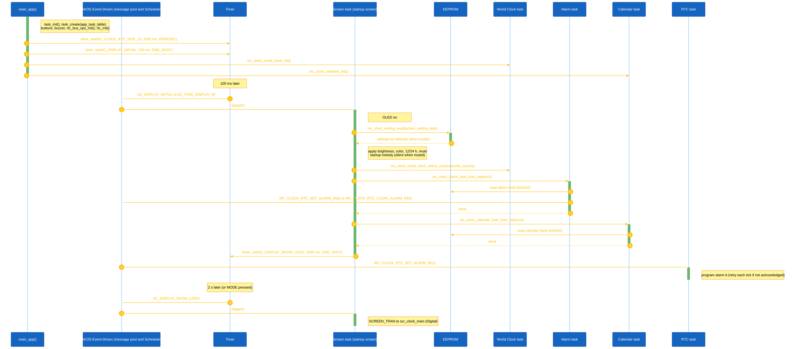
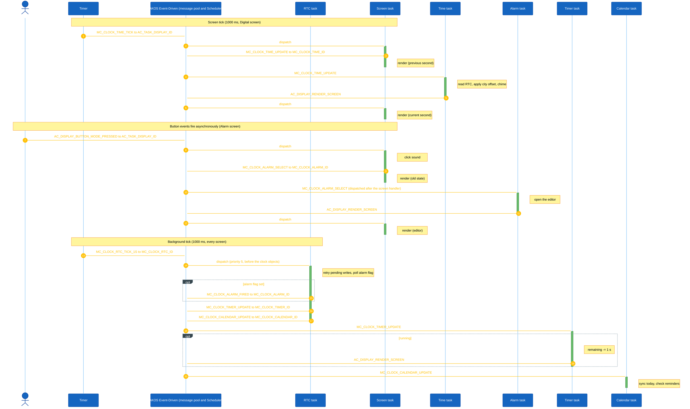
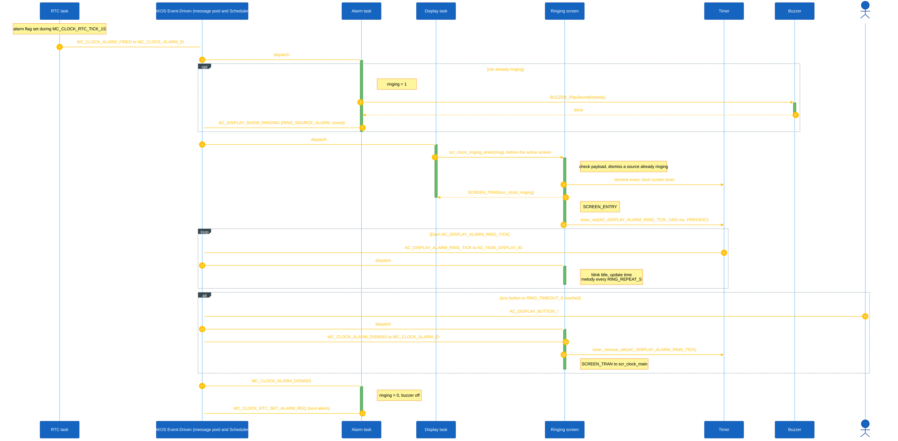

<h1 align="center">Runtime Signal Processing</h1>

This document explains how Mini Clock processes button input, task messages, screen ticks, the 1 s RTC tick, and object updates. The clock uses the AK event-driven task architecture: each clock object owns a task, receives signals through AK messages, and updates its own state.

## I. Overview

Mini Clock is implemented using event-driven tasks.

Each clock object owns:

- A dedicated task
- Its own signal handler
- Its own state data
- Its own update logic

The display task (`AC_TASK_DISPLAY_ID`) owns the screen manager and handles screen-level events. The active clock screen receives its periodic screen tick and the button signals, and posts update messages to the object it shows.

Input events from hardware buttons are converted into software signals. Button callbacks always post `AC_DISPLAY_BUTTON_*` signals to `AC_TASK_DISPLAY_ID`; the active screen handler decides what to do with them.

The background of the clock is driven by a periodic timer signal on the RTC task:

```c
MC_CLOCK_RTC_TICK_1S
```

The current tick interval is:

```c
MC_CLOCK_RTC_TICK_1S_INTERVAL = 1000 ms
```

Main runtime flow:

1. Button callbacks or timers create software signals.
2. Signals are posted into the AK message pool.
3. The AK scheduler dispatches messages to destination task handlers, higher priority first.
4. Each task updates only the state it owns.
5. After a change that a screen shows, the object posts `AC_DISPLAY_RENDER_SCREEN`; the screen render reads the latest object state through `mc_clock_<object>_get_state()` and refreshes the display buffer.

### High Level Architecture

#### 1. Clock Start



<p align="center"><strong><em>Figure 1:</em></strong> Clock start sequence logic</p>

Alarms are programmed only after the bank is read from EEPROM. Programming them earlier would save an empty bank over the stored one.

#### 2. Clock Running



<p align="center"><strong><em>Figure 2:</em></strong> Clock running sequence logic</p>

#### 3. Clock Ringing



<p align="center"><strong><em>Figure 3:</em></strong> Clock ringing sequence logic</p>

Timer and Calendar ring through the same path with `RING_SOURCE_TIMER` / `MC_CLOCK_TIMER_DISMISS` and `RING_SOURCE_CALENDAR` / `MC_CLOCK_CALENDAR_ALARM_DISMISS`.

## II. Code References

| Area | File |
|---|---|
| Task IDs and task handlers | `application/sources/app/task_list.h` |
| Task table registration | `application/sources/app/task_list.cpp` |
| Signal definitions | `application/sources/app/app.h` |
| Boot, start timers, button polling | `application/sources/app/app.cpp` |
| Button callback logic | `application/sources/app/app_bsp.cpp` |
| Display task and ringing hand-off | `application/sources/app/task_display.cpp` |
| Clock screens | `application/sources/app/screens/scr_clock_*.cpp` |
| RTC task | `application/sources/app/task_mc_rtc.cpp` |
| RTC driver and I2C bus helpers | `application/sources/driver/rtc/rtc.cpp`, `application/sources/platform/stm32l/io_cfg.c` |
| Screen manager | `application/sources/common/screen_manager.cpp` |

## III. Task Ownership

| Task | Priority | Responsibility | Owns Data | Receives Signals |
|---|---|---|---|---|
| `MC_CLOCK_RTC_ID` | 5 | Every RTC write, 1 s service tick, alarm flag polling | Pending time write, pending alarm write | `MC_CLOCK_RTC_TICK_1S`, `MC_CLOCK_RTC_SET_TIME_REQ`, `MC_CLOCK_RTC_SET_ALARM_REQ`, `MC_CLOCK_RTC_CLEAR_ALARM_REQ` |
| `AC_TASK_DISPLAY_ID` | 4 | Screen manager, render scheduling, button routing, screen ticks, ringing page | Current screen state, screen view state (menu item, lap scroll, animation) | All `AC_DISPLAY_*` signals, `MC_CLOCK_TIME_TICK`, `MC_CLOCK_STOPWATCH_TICK`, `MC_CLOCK_STOPWATCH_HELP`, `MC_CLOCK_TIMER_TICK` |
| `MC_CLOCK_TIME_ID` | 4 | Local time of the selected city, chime | `clock_state`, chime flag | `MC_CLOCK_TIME_SETUP`, `MC_CLOCK_TIME_UPDATE` |
| `MC_CLOCK_STOPWATCH_ID` | 4 | Elapsed time and laps | `mc_clock_stopwatch_state` | `MC_CLOCK_STOPWATCH_SETUP`, `MC_CLOCK_STOPWATCH_START_PAUSE`, `MC_CLOCK_STOPWATCH_RESET`, `MC_CLOCK_STOPWATCH_UPDATE`, `MC_CLOCK_STOPWATCH_LAP` |
| `MC_CLOCK_TIMER_ID` | 4 | Countdown | `mc_clock_timer_state` | `MC_CLOCK_TIMER_SETUP`, `MC_CLOCK_TIMER_START_PAUSE`, `MC_CLOCK_TIMER_RESET`, `MC_CLOCK_TIMER_INC`, `MC_CLOCK_TIMER_DEC`, `MC_CLOCK_TIMER_UPDATE`, `MC_CLOCK_TIMER_DISMISS`, `MC_CLOCK_TIMER_NEXT_FIELD`, `MC_CLOCK_TIMER_PREV_FIELD` |
| `MC_CLOCK_ALARM_ID` | 4 | Alarm list, editor, EEPROM bank, next RTC alarm | `mc_clock_alarm_state`, edit backup | `MC_CLOCK_ALARM_SETUP`, `MC_CLOCK_ALARM_SELECT`, `MC_CLOCK_ALARM_UP`, `MC_CLOCK_ALARM_DOWN`, `MC_CLOCK_ALARM_NEXT_FIELD`, `MC_CLOCK_ALARM_TOGGLE`, `MC_CLOCK_ALARM_DELETE`, `MC_CLOCK_ALARM_FIRED`, `MC_CLOCK_ALARM_DISMISS`, `MC_CLOCK_ALARM_ADD_NEW`, `MC_CLOCK_ALARM_REARM` |
| `MC_CLOCK_WORLD_CLOCK_ID` | 4 | Selected city (display time zone) | `world_clock` | `MC_CLOCK_WORLD_CLOCK_SETUP`, `MC_CLOCK_WORLD_CLOCK_UPDATE`, `MC_CLOCK_WORLD_CLOCK_SELECT_UP`, `MC_CLOCK_WORLD_CLOCK_SELECT_DOWN` |
| `MC_CLOCK_CALENDAR_ID` | 4 | Month view, day list, editor, EEPROM bank, reminders | `calendar`, edit backup | `MC_CLOCK_CALENDAR_SETUP`, `MC_CLOCK_CALENDAR_UPDATE`, `MC_CLOCK_CALENDAR_NEXT_MONTH`, `MC_CLOCK_CALENDAR_PREV_MONTH`, `MC_CLOCK_CALENDAR_ADD_EVENT`, `MC_CLOCK_CALENDAR_EDIT_EVENT`, `MC_CLOCK_CALENDAR_BACK`, `MC_CLOCK_CALENDAR_DELETE_EVENT`, `MC_CLOCK_CALENDAR_NEXT_FIELD`, `MC_CLOCK_CALENDAR_FIELD_INC`, `MC_CLOCK_CALENDAR_FIELD_DEC`, `MC_CLOCK_CALENDAR_ALARM_FIRED`, `MC_CLOCK_CALENDAR_ALARM_DISMISS` |

The kernel timer task (`TASK_TIMER_TICK_ID`, priority 7) delivers every timer signal above. The console runs from a polling task that only runs when every message queue is empty.

## IV. Button Event Processing

In Mini Clock, button callbacks always post `AC_DISPLAY_BUTTON_*` signals to `AC_TASK_DISPLAY_ID`. The currently active screen handler then decides what to do with them. The BSP does not need to know which screen is active.

The three buttons are polled every 10 ms by `sys_irq_timer_10ms()`. A press also re-arms the one-shot `AC_DISPLAY_SHOW_IDLE` timer (15 s).

### Button Processing Rules

| Button | BSP posts to AK | Active screen | Result inside the screen handler |
|---|---|---|---|
| MODE Pressed | `AC_DISPLAY_BUTTON_MODE_PRESSED` -> `AC_TASK_DISPLAY_ID` | Any clock screen | Select / open / start-pause, for example `MC_CLOCK_ALARM_SELECT`, `MC_CLOCK_STOPWATCH_START_PAUSE` |
| UP Pressed | `AC_DISPLAY_BUTTON_UP_PRESSED` -> `AC_TASK_DISPLAY_ID` | Any clock screen | Move up / increase, for example `MC_CLOCK_ALARM_UP`, `MC_CLOCK_TIMER_INC`, `MC_CLOCK_STOPWATCH_LAP` |
| DOWN Pressed | `AC_DISPLAY_BUTTON_DOWN_PRESSED` -> `AC_TASK_DISPLAY_ID` | Any clock screen | Move down / decrease, for example `MC_CLOCK_ALARM_DOWN`, `MC_CLOCK_TIMER_DEC` |
| MODE held 2 s | `AC_DISPLAY_BUTTON_LONG_MODE_PRESSED` -> `AC_TASK_DISPLAY_ID` | Any clock screen | Secondary action, for example `MC_CLOCK_ALARM_NEXT_FIELD`, `MC_CLOCK_STOPWATCH_RESET`, `MC_CLOCK_CALENDAR_ADD_EVENT` |
| UP held 2 s | `AC_DISPLAY_BUTTON_LONG_UP_PRESSED` -> `AC_TASK_DISPLAY_ID` | Any clock screen | For example `MC_CLOCK_ALARM_TOGGLE`, `MC_CLOCK_TIMER_RESET`, `MC_CLOCK_CALENDAR_PREV_MONTH` |
| DOWN held 2 s | `AC_DISPLAY_BUTTON_LONG_DOWN_PRESSED` -> `AC_TASK_DISPLAY_ID` | Any clock screen | For example `MC_CLOCK_ALARM_DELETE`, `MC_CLOCK_CALENDAR_NEXT_MONTH`, back to the menu |
| UP while MODE held | `AC_DISPLAY_BUTTON_MODE_UP_PRESSED` -> `AC_TASK_DISPLAY_ID` | Any clock screen | For example `MC_CLOCK_ALARM_ADD_NEW`, `MC_CLOCK_TIMER_NEXT_FIELD`, back to the menu |
| DOWN while MODE held | `AC_DISPLAY_BUTTON_MODE_DOWN_PRESSED` -> `AC_TASK_DISPLAY_ID` | Any clock screen | For example `MC_CLOCK_TIMER_PREV_FIELD`, back to the menu |
| Any | Any of the above | Ringing page | Post the source's dismiss signal and return to the Digital screen |

Note: the BSP posts on press and on long press only; there is no released event. The shell command `btn m|u|d|M|U|D|a|b` posts the same signals, so a test driven from the console follows this exact path.

## V. Runtime Scheduling Notes

The system uses asynchronous task-based scheduling.

Important runtime characteristics:

- Signals are queued in AK before they are handled.
- A sender posts a message; it does not directly execute the destination task handler.
- Handlers run to completion (RTC): a task processes one signal fully before pulling the next.
- Higher priority runs first: `MC_CLOCK_RTC_ID` (5) runs before the clock objects and the display task (4).
- Clock logic is decoupled through signals: a screen never changes an object's state directly, it posts a signal and reads a copy back with `mc_clock_<object>_get_state()`.
- The screen manager renders after every display message, at most once per `AC_DISPLAY_MINIMUM_SCREEN_RENDER_INTERVAL_MS` (50 ms); a render that comes too early is scheduled with a one-shot `AC_DISPLAY_RENDER_SCREEN`.
- The display renders a button or tick message before the object it posted to has run. That object posts `AC_DISPLAY_RENDER_SCREEN` after its change, so the view shows the new state at once instead of on the next tick.
- Each screen arms its own ticks on `SCREEN_ENTRY` and removes them before every `SCREEN_TRAN`. The menu and World Clock slide timers (`AC_DISPLAY_MENU_ANIM_TICK`, `AC_DISPLAY_WORLD_ANIM_TICK`, 50 ms) run only while an item slides, so an idle screen renders once a second.
- `MC_CLOCK_TIME_TICK`, `MC_CLOCK_STOPWATCH_TICK` and `MC_CLOCK_TIMER_TICK` share one value (`MC_CLOCK_DEFINE_SIG`) on the display task. They are only sent by a screen's own timer; never post one of them to the display task from another task.
- Timer, Stopwatch and Calendar reminders keep running on any screen: Timer and Calendar run on the RTC task's background tick, Stopwatch on its own `MC_CLOCK_STOPWATCH_UPDATE` timer.
- RTC writes cross task boundaries only through requests: Alarm posts `MC_CLOCK_RTC_SET_ALARM_REQ` / `MC_CLOCK_RTC_CLEAR_ALARM_REQ`, the time setting screen posts `MC_CLOCK_RTC_SET_TIME_REQ`, and RTC and World Clock post `MC_CLOCK_ALARM_REARM` after the time or the city changes.
- Ringing is a display-task hand-off: `task_display` passes `AC_DISPLAY_SHOW_RINGING` to `scr_clock_ringing_enter()` before the active screen sees it, so any screen can be interrupted.
- A common-message payload is at most 64 bytes; every handler checks `get_data_len_common_msg()` before it casts `get_data_common_msg()`.
- Two short blocking operations remain inside handlers. EEPROM writes program the data EEPROM byte by byte; saving the calendar bank (about 150 bytes) can cut short a console reply sent right after it. I2C transfers to the RTC take about a millisecond; the driver checks the BUSY flag first, recovers a stuck bus, and backs off for 5 s after a failure.
- RAM is 13.3 of 16 KB: about 3 KB of stack and a 2 KB heap. Object state copies on the stack are kept small and the world clock table lives in flash. The message pools hold 32 pure, 8 common and 8 dynamic messages, with 16 timers (`ak.cfg.mk`).
