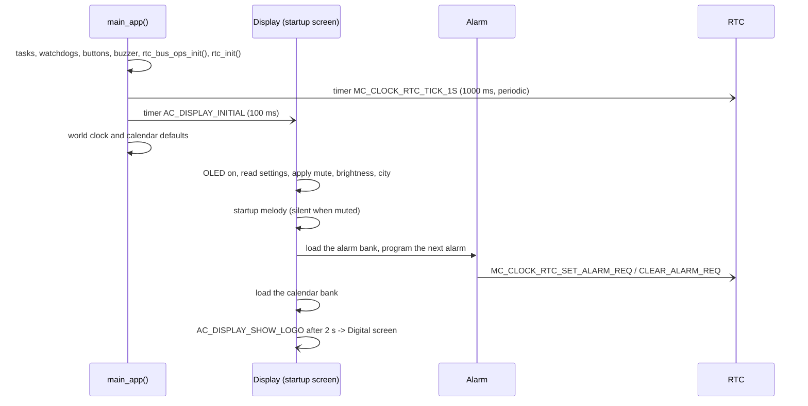
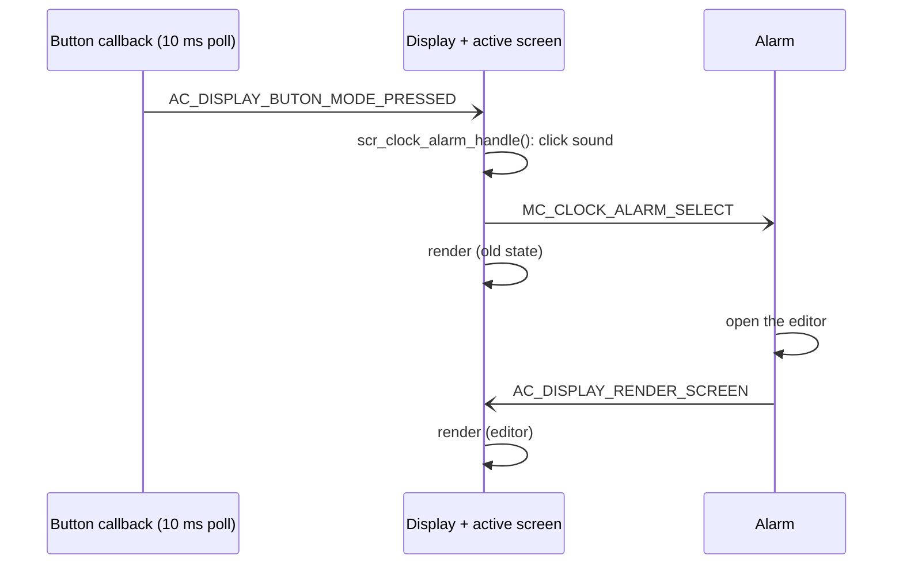
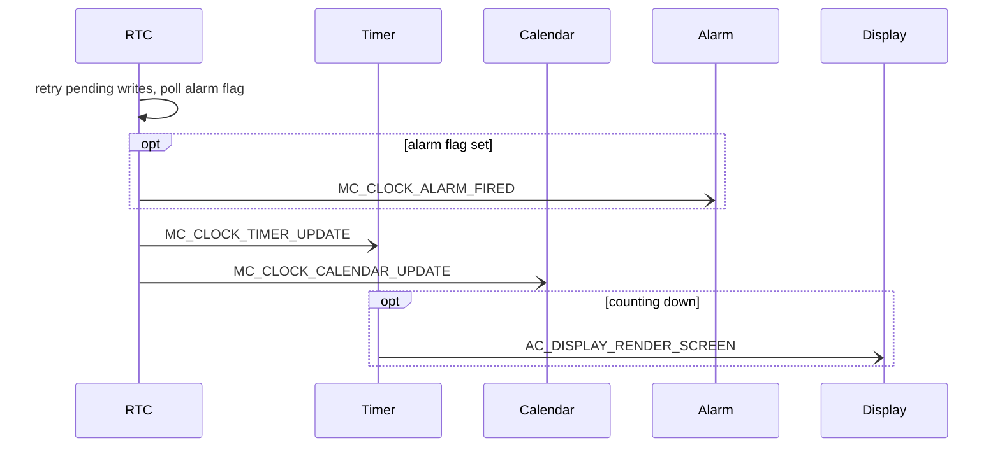
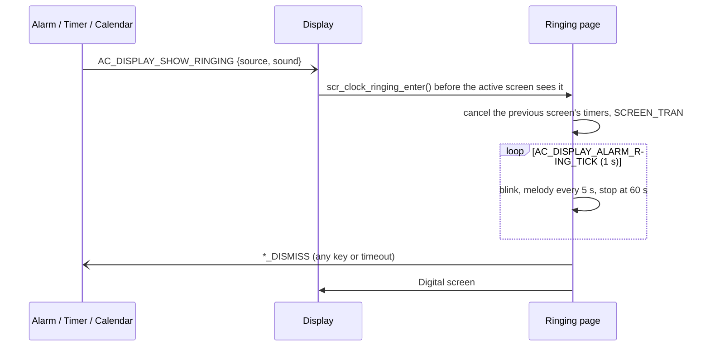

<h1 align="center">Runtime Signal Processing</h1>

This document follows a button press, a one-second tick and a ringing event through the AK tasks
of Mini Clock: which task handles what, in which order, and why the screen is redrawn when it is.
Object-level details are in [Clock Object Sequences](02-design-sequence-object.md).

## I. Overview

AK is an event-driven, run-to-completion kernel. Every task handler runs one message to the end
without blocking; work that has to happen later is a timer that posts a signal. Higher-priority
tasks run first, and the console polling task runs only when every message queue is empty.

| Task | Priority | Wakes up on |
|---|---|---|
| `TASK_TIMER_TICK_ID` | 7 | Kernel timer tick |
| `MC_CLOCK_RTC_ID` | 5 | 1 s service tick, RTC write requests |
| `AC_TASK_DISPLAY_ID` | 4 | Buttons, screen timers, render requests, ringing requests |
| `MC_CLOCK_TIME_ID`, `MC_CLOCK_STOPWATCH_ID`, `MC_CLOCK_TIMER_ID`, `MC_CLOCK_ALARM_ID`, `MC_CLOCK_WORLD_CLOCK_ID`, `MC_CLOCK_CALENDAR_ID` | 4 | Signals from screens and from the RTC task |
| Console polling | idle | UART bytes, when all queues are empty |

### 1. Boot

Alarms are programmed only after the bank is read from EEPROM. Programming them earlier would save
an empty bank over the stored one.

### 2. Button to Screen to Object

The buttons are polled every 10 ms by `sys_irq_timer_10ms()`. The BSP callbacks in
`app_bsp.cpp` post one Display signal per event:

| Event | Display signal |
|---|---|
| Press (Mode / Up / Down) | `AC_DISPLAY_BUTON_MODE_PRESSED` / `_UP_` / `_DOWN_` |
| Hold for 2 s | `AC_DISPLAY_BUTON_LONG_MODE_PRESSED` / `_LONG_UP_` / `_LONG_DOWN_` |
| Up or Down while Mode is held | `AC_DISPLAY_BUTON_MODE_UP_PRESSED` / `_MODE_DOWN_` |

The active screen translates the signal into an object signal. The object changes its state and,
because Display already rendered the button message before the object ran, posts
`AC_DISPLAY_RENDER_SCREEN` so the view shows the new state immediately.

The shell command `btn` posts the same Display signals, so automated tests follow this exact path.

### 3. One Second in the Background

Timer, Calendar reminders and Alarm ring on any screen because they are driven by this tick, not
by their own screens.

### 4. Ringing

## II. Code References

| Topic | Files |
|---|---|
| Boot, timers, button polling | `application/sources/app/app.cpp` |
| Button callbacks | `application/sources/app/app_bsp.cpp` |
| Display task | `application/sources/app/task_display.cpp`, `application/sources/common/screen_manager.cpp` |
| Screens | `application/sources/app/screens/scr_*.cpp` |
| RTC task and driver | `application/sources/app/task_mc_rtc.cpp`, `application/sources/driver/rtc/rtc.cpp` |
| I2C bus helpers | `application/sources/platform/stm32l/io_cfg.c` (`io_i2c1_bus_busy()`, `io_i2c1_bus_recover()`) |
| Shell commands | `application/sources/app/shell.cpp` |

## III. Screen Timers

Each screen owns the Display timers it sets on `SCREEN_ENTRY` and removes them before every
`SCREEN_TRAN` / `SCREEN_BACK`. The ringing page cancels them for the screen it interrupts.

| Screen | Timer signal | Interval | Purpose |
|---|---|---|---|
| Digital, Analog, Menu | `MC_CLOCK_TIME_TICK` | 1000 ms | Post `MC_CLOCK_TIME_UPDATE` |
| Menu | `AC_DISPLAY_MENU_ANIM_TICK` | 50 ms | Only while an item slides |
| World Clock | `MC_CLOCK_TIME_TICK` | 1000 ms | Post `MC_CLOCK_WORLD_CLOCK_UPDATE` |
| World Clock | `AC_DISPLAY_WORLD_ANIM_TICK` | 50 ms | Only while the card slides |
| Stopwatch | `MC_CLOCK_STOPWATCH_TICK` / `MC_CLOCK_STOPWATCH_HELP` | 100 ms / 5 s | Redraw / hide the help text |
| Timer | `MC_CLOCK_TIMER_TICK` | 1000 ms | Redraw and the help text |
| Calendar | `MC_CLOCK_TIME_TICK` | 1000 ms | Redraw |
| Ringing | `AC_DISPLAY_ALARM_RING_TICK` | 1000 ms | Blink, melody, timeout |

`MC_CLOCK_TIME_TICK`, `MC_CLOCK_TIMER_TICK` and `MC_CLOCK_STOPWATCH_TICK` all have the value 100
(`MC_CLOCK_DEFINE_SIG`). They are only ever sent by a screen's own timer; never post one of them to
Display from another task, or the active screen will treat it as its own tick.

## IV. Runtime Scheduling Notes

### Render Scheduling

`scr_mng_dispatch()` renders after every Display message, at most once per 50 ms
(`AC_DISPLAY_MINIMUM_SCREEN_RENDER_INTERVAL_MS`); a render that comes too early is scheduled with a
one-shot `AC_DISPLAY_RENDER_SCREEN`. Objects post the same signal after they change what a screen
shows (time, world clock, timer, alarm, calendar). An idle screen therefore only renders once a
second, which leaves the CPU free for the console.

### Blocking Work

Handlers must not wait. Two short blocking operations remain inside handlers and are kept small:

- **EEPROM writes** program the data EEPROM byte by byte. Saving the calendar bank (about 150 bytes)
  is long enough that a console reply sent right after it can be cut short; capture scripts wait
  after a save before reading the screen.
- **I2C transfers** to the RTC take about a millisecond. The vendor `twi.cpp` waits up to about
  1.7 s when the chip does not answer; the RTC driver checks the BUSY flag first, recovers the bus,
  and backs off for 5 s after a failure instead of retrying immediately.

### Memory

RAM is 13.3 of 16 KB: about 3 KB of stack and a 2 KB heap. Snapshots copied to the stack are kept
small; the world-clock table lives in flash. The message pools are 32 pure, 8 common and 8 dynamic
messages, and 16 timers (`ak.cfg.mk`).
